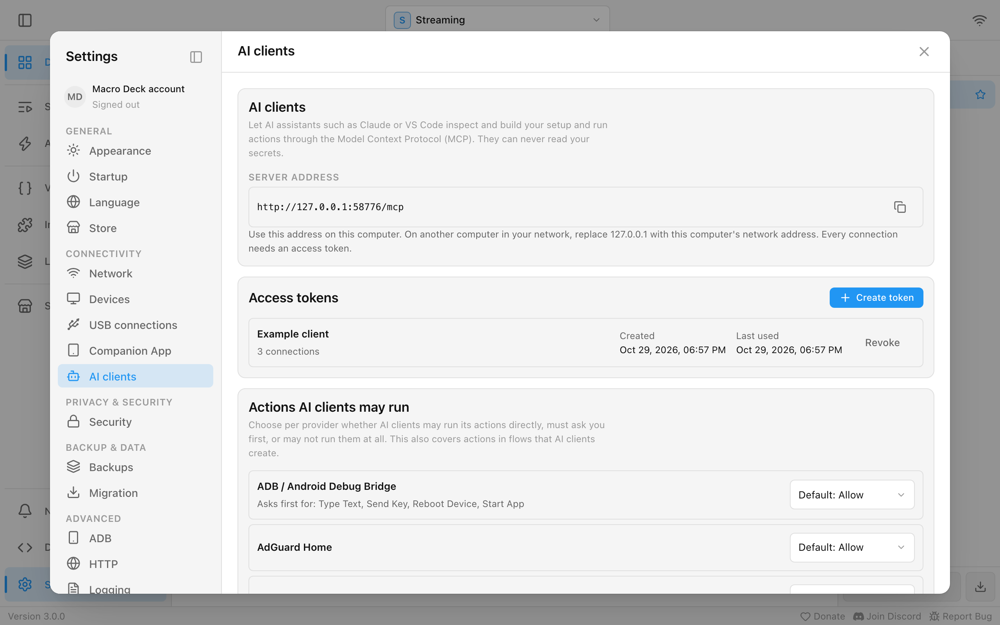
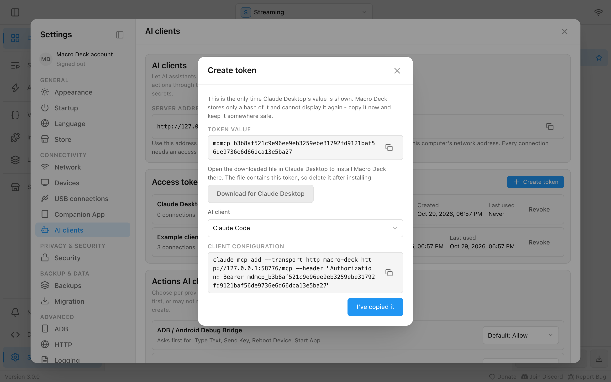
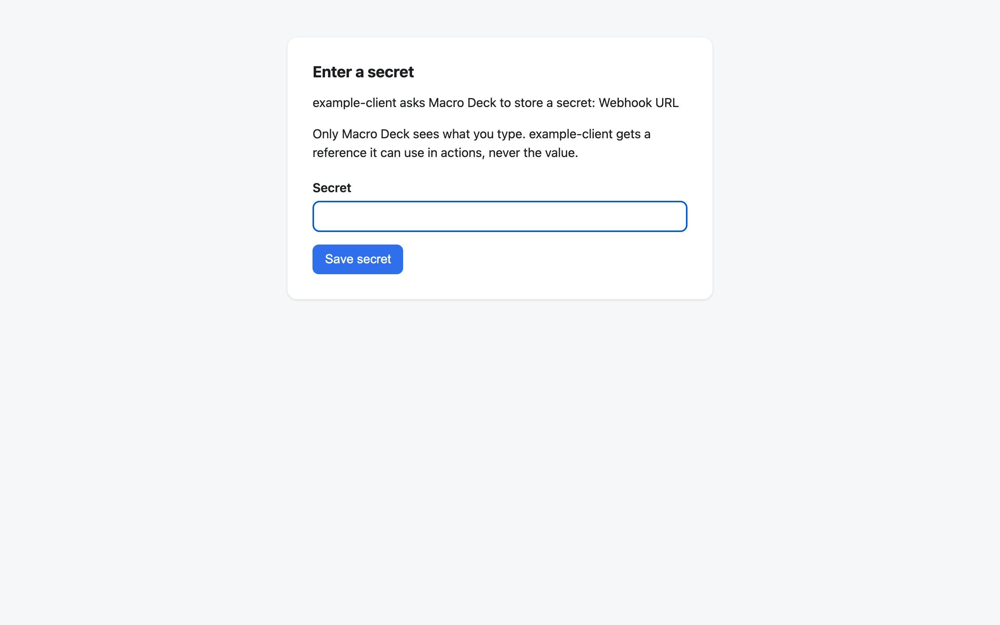
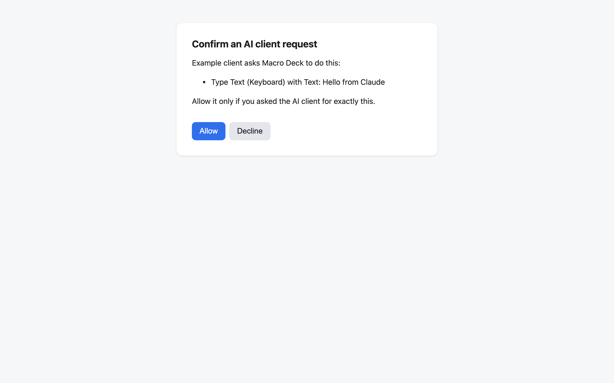

AI assistants such as Claude or VS Code can work with your Macro Deck setup through the Model Context
Protocol (MCP): look at your profiles, folders, buttons, scripts and automations, build new ones, and run
actions. They never see your secrets. Everything is set up in **Settings > AI clients**.

Only apps on the same computer as Macro Deck can connect.

## Create an access token

Every AI client connects with an access token.

1. Open **Settings > AI clients** and choose **Create token** under **Access tokens**.
2. Give it a name you will recognize later, such as the client or computer it is for, and choose **Create**.
3. Macro Deck shows the token value once. Connect your client now, as described below, then choose
   **I've copied it**.

Macro Deck keeps only a fingerprint of the token, so it cannot show the value again. If you lose it,
create a new token. A token does not expire; it works until you revoke it.

## Connect Claude Desktop

While the new token is shown, choose **Download for Claude Desktop** and save the file `macro-deck.mcpb`. Open it, for example by double-clicking it, and Claude Desktop installs Macro Deck
as an extension. Macro Deck must be running whenever Claude uses it.

The button appears only when Macro Deck runs as the installed app on macOS or Windows, the systems Claude
Desktop runs on.

The file contains the token. Delete it once the extension is installed, and if you shared it with
anyone, revoke the token.

The extension keeps working when Macro Deck restarts on a different port. After you revoke its token, it
stops working: create a new token and install the extension again from the new download.

## Connect Claude Code, VS Code and other clients

While the new token is shown, choose your client under **AI client**, then copy **Client configuration**:

- **Claude Code**: a `claude mcp add` command. Run it in a terminal.
- **VS Code**: an entry for your `mcp.json`. Paste it into the file, or merge its `servers` entry into the one
  that is already there.
- **Other clients**: an `mcpServers` entry that most other MCP clients accept in their configuration file.

Macro Deck never edits a client's configuration for you.

These configurations contain the address under **Server address**, which uses the port shown in
**Settings > Network**. It stays the same until you change that port.

To use an AI client on another computer in your network, replace `127.0.0.1` in the configuration with
the network address of the computer running Macro Deck, and allow Macro Deck through its firewall as for
your other devices. The access token is what keeps other people in your network out, so treat it like a
password. On a network you do not trust, connect only clients on this computer.

## What an AI client can and cannot do

An AI client can read your setup, create and change widgets, folders, profiles, scripts and automations,
run actions and scripts, and trigger events. It cannot:

- read a secret, a password, a backup or its recovery key, or the settings of an integration;
- run an action of a provider that is set to **Off**.

When the client needs a new secret, for example a webhook URL, Macro Deck opens a page in your browser and
you type the value there. The client only gets a reference to the stored secret, never the value. The
page works once and for 10 minutes. A step that uses a stored secret still needs your
[approval](/guide/tips/#approvals) after an AI client changed it, like any other change.

## Actions AI clients may run

Under **Actions AI clients may run** you choose for each provider:

- **Allow**: AI clients run its actions directly.
- **Ask first**: Macro Deck asks you before every one of its actions and runs it only if you agree. A client
  with its own confirmation dialog shows the question there. A client without one, such as Claude Desktop,
  opens a Macro Deck page in your browser instead, where you choose **Allow** or **Decline**. The page
  works once and for 5 minutes, and runs nothing until you answer.
- **Off**: AI clients cannot run its actions.

**Default** keeps Macro Deck's choice, shown next to it. Built-in actions that run programs and scripts,
press keys, use files or the network, or shut the computer down ask first by default, and so does every
plugin action. The setting also covers actions that a script or automation runs when an AI client starts it.

## Undo changes

You can ask the AI client to undo its changes. Macro Deck keeps the last 20 changes of all AI clients
together, and restoring a backup clears them. Anything you edited yourself since the change stays as it
is. The details are in [the developer reference](/reference/mcp/#undo).

## Connected clients and revoking a token

**Connected clients** lists the clients that are connected right now, with the token each one uses.
**Refresh** updates the list.

**Revoke** next to a token disconnects every client using it immediately, and the token stops working for
good. A revoked token can then be removed from the list.

## Problems

See [Troubleshooting](/guide/troubleshooting/#an-ai-client-cannot-connect).
