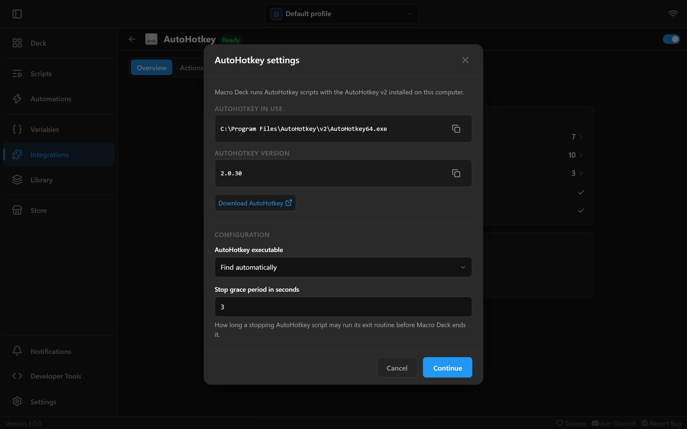
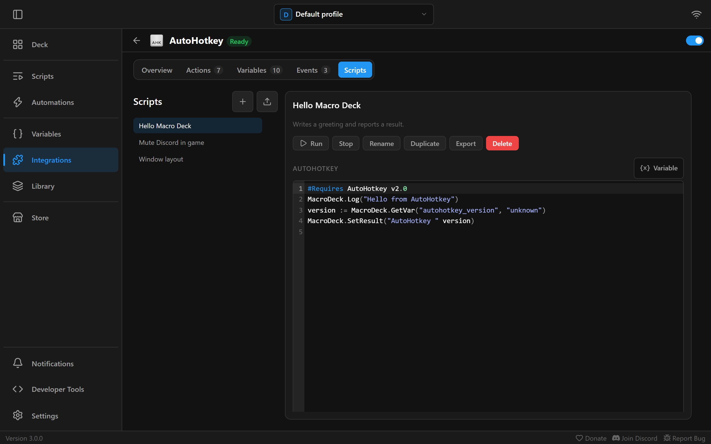
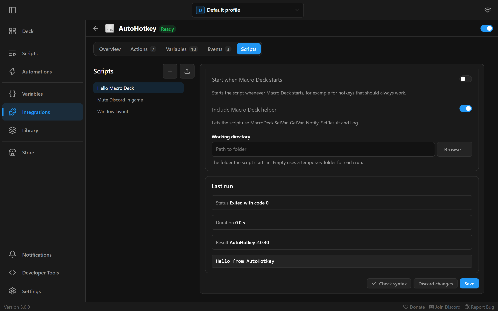

The **AutoHotkey** integration runs [AutoHotkey v2](https://www.autohotkey.com/) scripts from your buttons:
sending keys to a window in the background, arranging windows, app-specific hotkeys and anything else
AutoHotkey can do. You keep your scripts in Macro Deck, edit and test them there, start and stop them from a
button, and see whether they are running. Scripts can read and set Macro Deck variables and show
notifications through a small helper Macro Deck adds to them.

It is available on Windows only, because AutoHotkey runs only there, and it is off until you turn it on.
Only AutoHotkey v2 is supported. Scripts written for AutoHotkey v1 do not run.

In Macro Deck, **Scripts** on their own are the visual action flows you build in the app. The scripts this
page is about are always called **AutoHotkey scripts**.

## Set up AutoHotkey

1. Install AutoHotkey v2 from the [official download page](https://www.autohotkey.com/download/). Macro Deck
   does not include AutoHotkey.
2. In Macro Deck, open **Integrations**, choose **AutoHotkey** and turn it on.

Macro Deck looks for AutoHotkey v2 by itself, in this order:

1. Where the AutoHotkey installer recorded it in the registry, for all users or just for you.
2. `C:\Program Files\AutoHotkey`, the default for an installation for all users.
3. `%LocalAppData%\Programs\AutoHotkey`, the default for an installation just for you.

In the installation it uses `v2\AutoHotkey64.exe`, or `v2\AutoHotkey32.exe` on 32-bit Windows. The AutoHotkey
version it found appears in the AutoHotkey settings and in the `autohotkey_version` variable.

### A portable AutoHotkey

If you use AutoHotkey without installing it, or keep it somewhere else, open the integration's
**AutoHotkey settings** with **Set up** in the **Configuration** section of its **Overview**. Set
**AutoHotkey executable** to **Choose the executable** and pick `AutoHotkey64.exe` or `AutoHotkey32.exe` as
**Executable**. Macro Deck checks that the file exists, is AutoHotkey v2 and starts. **AutoHotkey in use**
shows the executable Macro Deck runs and its version.



The same settings have the **Stop grace period in seconds**: how long a script that is asked to stop may run its exit
routine before Macro Deck ends it. It is 3 seconds unless you change it, and can be 0.5 to 5 seconds.

The integration has to be turned on to change its settings. Saving them takes effect at once and keeps
running AutoHotkey scripts running.

### When AutoHotkey is not found

Until Macro Deck finds a working AutoHotkey v2, the integration shows the issue **AutoHotkey not found**,
**AutoHotkey v2 required** (for AutoHotkey v1) or **AutoHotkey does not start**. **Learn more** on the issue
opens the AutoHotkey download page. After installing, choose **Check again**.

You can still write and edit scripts in the meantime. Actions that run a script fail with
"AutoHotkey v2 is not available", and scripts set to start with Macro Deck do not start.

## The Scripts tab

The AutoHotkey integration's page has a **Scripts** tab beside its other tabs. It is your library of
AutoHotkey scripts. Buttons refer to a script there by an id that never changes, so renaming a script keeps
every button working. The library is part of your [backups](/guide/backups/).

The tab is laid out like Macro Deck's own **Scripts** page: your AutoHotkey scripts are listed on the left,
and the one you choose opens on the right.



- **+** next to the list title creates a new script from a name and an optional description.
- The upload button next to it opens **Import an .ahk file**. It adds an `.ahk` file as a new script named
  after the file. The file must be UTF-8 text, with or without a byte order mark, and at most 1 MiB.
  Imported scripts run with your permissions, so only import scripts you trust.
- The list shows **Running** next to a script while it runs. Choose a script to open it.

With a script open, its description shows under its name, followed by these buttons:

- **Run** runs the text in the editor, saved or not. When the script is already running, it restarts it.
  **Stop** stops it.
- **Rename** changes the name and description. **Duplicate** makes a copy. **Export** saves the script as
  `<name>.ahk` in a folder you choose and asks before replacing a file that is already there. **Delete**
  removes it; buttons that run a deleted script fail until you choose another one.

Below them:

- Write the script in the editor, which highlights AutoHotkey v2 and has line numbers, search and undo.
  **Variable** puts `MacroDeck.GetVar("name")` for the variable you pick at the cursor.
- **Check syntax** asks AutoHotkey whether the script loads, without running it, and shows the line of the
  first error under the editor. A script with errors can still be saved.
- **Save** stores the script, **Discard changes** goes back to the saved version. **Unsaved changes** shows
  next to the script's name until you save.

Under **Settings** each script has:

| Setting | What it does |
| --- | --- |
| Start when Macro Deck starts | Starts the script whenever Macro Deck starts, see [Scripts that keep running](#scripts-that-keep-running) |
| Include Macro Deck helper | Lets the script use `MacroDeck.SetVar`, `GetVar`, `Notify`, `SetResult` and `Log`. On by default |
| Working directory | The folder the script starts in, `A_WorkingDir`. Empty uses the temporary folder of each run |

**Last run** shows how the latest run went: its **Status** (for example **Exited with code 0**,
**Failed to start** or **Timed out**), its **Duration**, the **Result** the script reported, an error with
its line, and what the script wrote to its output. The output keeps the newest 16 KiB.



AutoHotkey never shows its error dialogs for scripts Macro Deck runs. Load errors and runtime errors appear
under **Last run** instead.

## Actions

| Action | What it does |
| --- | --- |
| Run AutoHotkey script | Runs a script from the Scripts tab |
| Run AutoHotkey file | Runs an `.ahk` file where it is stored on your computer |
| Run inline AutoHotkey code | Runs AutoHotkey v2 code written in the action itself |
| Stop AutoHotkey script | Stops a script or file Macro Deck started |
| Restart AutoHotkey script | Stops a script or file and starts it again with new parameters. Starts it when it is not running |
| Toggle AutoHotkey script | Starts a script or file when Macro Deck does not run it, and stops it when it does |
| Open Window Spy | Opens AutoHotkey's Window Spy to look up window titles, classes and controls |

The three run actions share these settings:

| Setting | What it does |
| --- | --- |
| Parameters | Names and values the script reads as `MacroDeck.Params["name"]`, see [Parameters](#parameters) |
| When already running | What happens when Macro Deck already runs this script: **Do nothing** (the default), **Start another instance**, **Restart it** or **Fail the action** |
| Wait until it finishes | The action finishes when the script ends, and fails when it exits with an error code or reports an error. Off by default: the action finishes once the script has started and loaded, so errors in the script still make it fail |
| Timeout | Only while waiting. Macro Deck stops the script when it runs longer, at most 9 minutes. 60 seconds unless you change it |
| Output variable | Only while waiting. Receives the text the script sets with `MacroDeck.SetResult`, or else its output |

On top of that:

- **Run AutoHotkey script** has **AutoHotkey script**, the script to run.
- **Run AutoHotkey file** has **AutoHotkey file**; **Arguments**, a list the script receives in `A_Args`,
  where each argument can use variables such as `{{ vars.volume }}`; **Working directory**, which defaults to
  the folder of the file; and **Include Macro Deck helper**, which is off for files.
- **Run inline AutoHotkey code** has **AutoHotkey code**, edited in the same editor as the Scripts tab, with
  **Insert variable**. It always includes the Macro Deck helper.
- **Stop**, **Restart** and **Toggle AutoHotkey script** have **Target**, either **AutoHotkey script from the
  library** with **AutoHotkey script**, or **AutoHotkey file** with **AutoHotkey file**. **Restart** and
  **Toggle** also have **Parameters**. **Stop** has **Stop all instances**, on by default; when off, only the
  most recently started instance stops.

Stopping asks the script to close first, so its `OnExit` routine runs, and ends it after the
**Stop grace period in seconds** when it does not. A script that is not running counts as stopped. Stop and Toggle only
ever touch scripts Macro Deck started: an AutoHotkey script you started yourself keeps running.

A **Toggle AutoHotkey script** button shows **Running** or **Not running**, so you can give each state its
own look.

**Open Window Spy** uses the Window Spy of the AutoHotkey installation Macro Deck found.

## Parameters

Macro Deck never puts values into the text of a script, so a value cannot break or change your code. Pass
them as **Parameters** instead. Each parameter has a name and a value, and the value can use variables, for
example `{{ vars.volume }}`:

```ahk2
SoundSetVolume MacroDeck.Params["volume"]
MsgBox "Hello " MacroDeck.Params["name"]
```

- Names use letters, digits and underscores, and do not start with a digit, like `volume` or `window_title`.
- Values always arrive as text, exactly as entered, quotes, backticks, line breaks and `%` included. Convert
  them yourself when you need a number, for example with `Integer(MacroDeck.Params["volume"])`.
- `MacroDeck.Params` is there even when the helper is off. Use `MacroDeck.Params.Has("name")` to check
  whether a parameter was passed.

**Run AutoHotkey file** also has **Arguments**, which arrive in `A_Args` unchanged, spaces and quotes
included.

## The Macro Deck helper

With **Include Macro Deck helper** on, a script can talk to Macro Deck through the `MacroDeck` class:

| Call | What it does |
| --- | --- |
| `MacroDeck.Params["name"]` | The value of a parameter, see above |
| `MacroDeck.IsAvailable` | `true` when the helper is included. Without it, `MacroDeck` only has `Params` |
| `MacroDeck.GetVar(name)` | The current value of a Macro Deck variable, as text. Throws an error when the variable does not exist or cannot be read |
| `MacroDeck.GetVar(name, default)` | The same, but returns `default` instead of throwing |
| `MacroDeck.SetVar(name, value)` | Sets a Macro Deck variable. When no variable has that name, Macro Deck creates a text variable |
| `MacroDeck.Notify(title, message, severity)` | Shows a notification in Macro Deck. `severity` is `"info"` (the default), `"warning"` or `"error"` |
| `MacroDeck.SetResult(text)` | Reports the script's result: shown under **Last run**, in `autohotkey_last_result` and in the action's **Output variable** |
| `MacroDeck.Log(text)` | Adds a line to the script's output under **Last run** |

```ahk2
count := Integer(MacroDeck.GetVar("presses", "0")) + 1
MacroDeck.SetVar("presses", count)
if count >= 100
    MacroDeck.Notify("Milestone", "You pressed it " count " times", "info")
MacroDeck.SetResult(count)
```

`GetVar` reads a variable the way the action that started the script sees it: a variable local to the
widget, script or automation the action runs in comes before a global one of the same name. It waits for
Macro Deck's answer, which normally takes a moment. `SetVar` sets variables the same way.

Some limits keep a runaway script from flooding Macro Deck:

- A script can show up to 5 notifications every 10 seconds; more are dropped.
- Macro Deck handles up to 200 helper calls per second from one script. A message longer than 16 KiB is
  dropped. A `GetVar` over either limit fails instead of waiting.

### Errors

When a script fails at run time, the helper reports the error and its line to Macro Deck instead of showing
AutoHotkey's error dialog. It appears under **Last run**, in `autohotkey_last_error`, in the
**AutoHotkey script failed** event, and makes a waiting action fail.

If your script handles errors itself with `OnError`, register your handler in front of the helper's, or it
is never called:

```ahk2
OnError(MyHandler, -1)
```

## Scripts that keep running

Scripts with hotkeys, timers or `Persistent` keep running until they are stopped. For those:

- Turn on **Start when Macro Deck starts** in the script's **Settings** to have it running whenever Macro Deck
  is.
- Put a **Toggle AutoHotkey script** action on a button to start and stop it, and give the **Running** and
  **Not running** states their own look.
- Each script in the library has a variable that says whether it runs, `autohotkey_script_<name>_running`,
  for example `autohotkey_script_mute_discord_running`. The name is made from the script's name when you
  create it and stays the same when you rename the script, so buttons and conditions that use it keep
  working.

When Macro Deck exits, or you turn the integration off, Macro Deck stops all the AutoHotkey scripts it
started. They do not survive Macro Deck closing or crashing.

## Variables

| Variable | Shows |
| --- | --- |
| `autohotkey_installed` | Whether Macro Deck found a working AutoHotkey v2 |
| `autohotkey_version` | The AutoHotkey version it uses |
| `autohotkey_running_scripts` | How many AutoHotkey scripts Macro Deck runs right now |
| `autohotkey_last_script` | The script that ended or failed last |
| `autohotkey_last_exit_code` | Its exit code |
| `autohotkey_last_result` | What it reported with `MacroDeck.SetResult` |
| `autohotkey_last_error` | Why it failed, when it did |
| `autohotkey_script_<name>_running` | Whether that script from the library runs, one for each script |

## Events

These events start automations. The actions they run can use the event's values, such as
`{{ event.exitCode }}`:

| Event | When it happens | Values |
| --- | --- | --- |
| AutoHotkey script started | A script Macro Deck started has loaded and runs | `script` |
| AutoHotkey script exited | Such a script has ended | `script`, `exitCode`, `durationMs` (how long it ran, in milliseconds) |
| AutoHotkey script failed | A script could not be started or loaded, reported an error, or did not finish in time | `script`, `reason` |

`reason` is one of `start_failed`, `load_error`, `runtime_error` or `timeout`.

## Good to know

- **Where a script runs.** Scripts from the Scripts tab and inline code are written to a temporary folder for
  each run, under `%TEMP%\MacroDeck\autohotkey`, which Macro Deck deletes when the run ends. `A_ScriptDir`
  is that folder, so do not keep files next to the script there; set a **Working directory** or use full
  paths. **Run AutoHotkey file** runs the file where it is, so `A_ScriptDir` is its folder.
- **`Reload` and running as administrator.** A script that reloads itself, or restarts itself elevated with
  `*RunAs`, starts a new AutoHotkey process. Macro Deck sees the script as ended; the new process is no longer
  under its control, so Stop and Toggle cannot stop it and it keeps running after Macro Deck exits. Use
  **Restart AutoHotkey script** instead of `Reload`.
- **Apps a script starts keep running.** When Macro Deck stops a script, or exits, it ends only the AutoHotkey
  process. A program the script opened with `Run` stays open. Window Spy also stays open.
- **Windows of programs running as administrator.** Macro Deck runs scripts without administrator rights, and
  Windows does not let them send keys or clicks to a window of a program that runs as administrator.
- **`#SingleInstance`.** AutoHotkey applies it on top of **When already running**. For **Run AutoHotkey
  file** it compares the file, so `#SingleInstance Force` closes a copy of the same file you started yourself.
- **Output with other characters.** Macro Deck reads a script's output as UTF-8. Text written with
  `FileAppend` to `*` without an encoding can show up garbled when it has characters outside plain English.
  Use `FileAppend(text "`n", "*", "UTF-8-RAW")` or `MacroDeck.Log(text)`.
- **Long lines.** A single helper message over 16 KiB is dropped, see the limits above.

## Coming from Macro Deck 2

When you migrate from Macro Deck 2, buttons that used the AutoHotkey plugin by jbcarreon123 move over:

- **Run AHKv2 Script** becomes **Run AutoHotkey file** with the same file, set to **Start another instance**
  as the old plugin did.
- **Write and Run AHKv2 Script** becomes **Run inline AutoHotkey code** with the same code, also set to
  **Start another instance**. Macro Deck 2 filled in `{{ }}` variable placeholders inside the code; Macro
  Deck 3 never changes your code, so the migration warns about code that contains `{{`. Pass the values as
  **Parameters** and read them with `MacroDeck.Params`, or read variables with `MacroDeck.GetVar`.
- **Window Spy** becomes **Open Window Spy**.

The AutoHotkey v1 actions are not migrated, because Macro Deck 3 supports AutoHotkey v2 only. Turn on the
AutoHotkey integration and install AutoHotkey v2 after the migration; until then, the migrated buttons fail.

## Troubleshooting

- **AutoHotkey not found although it is installed:** Macro Deck needs AutoHotkey v2 with `v2\AutoHotkey64.exe`
  in the installation folder. Reinstall AutoHotkey v2, or choose the executable in the AutoHotkey settings.
- **A button does nothing:** with **When already running** on **Do nothing**, pressing it while the script
  still runs does nothing. Look at the script's state on the Scripts tab, or stop it first.
- **"could not be loaded because of an error on line…":** run **Check syntax** on the Scripts tab. Code
  written for AutoHotkey v1 does not load in v2.
- **A script that sends keys does nothing in a game or tool:** the window may belong to a program running as
  administrator, see [Good to know](#good-to-know).
- **`MacroDeck.GetVar` throws "was not found":** check the variable's name, or pass a default:
  `MacroDeck.GetVar("name", "")`.
- **"Macro Deck rejected this request":** the script sent too many helper calls or one longer than 16 KiB.
- **"Too many AutoHotkey scripts are running":** Macro Deck runs at most 32 AutoHotkey scripts at once. Stop
  some first.
