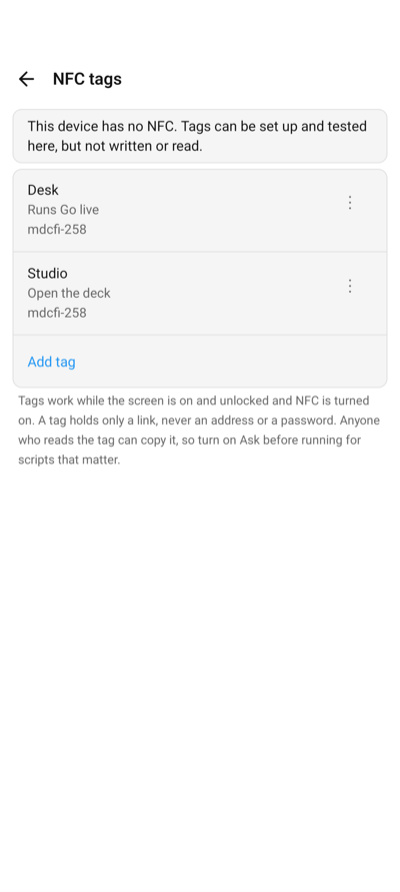

An NFC tag on your desk can open a computer's deck in the Companion app, run a Macro Deck
[script](/guide/concepts/#scripts-and-automations), or do both. You set up each tag in the app and write it to an
NFC sticker, card or key fob. Any rewritable NDEF tag works, for example an NTAG213, NTAG215 or NTAG216.

A tag holds only a link, never the computer's address, your account or a password. Which computer and which
script it stands for are saved in the app on your device, so a tag only works on a device you set it up on.

## Set up a tag

1. Open the app settings and choose **NFC tags** (**NFC Tags** on iPhone).
2. Choose **Add tag** (**Add Tag** on iPhone).
3. Give the tag a name and choose what it does when tapped (**When tapped**, **When Tapped** on iPhone):
   - **Open the deck** (**Open the Deck** on iPhone): opens the deck of the computer you choose.
   - **Run a script** (**Run a Script**): runs a script on that computer, without opening the deck.
   - **Open the deck and run a script** (**Open the Deck and Run a Script**): opens the deck and runs the script on it.
4. Choose the computer and, for a script, the script. The app connects to the computer to list its scripts. A
   script that takes values cannot be chosen, because a tag carries none.
5. Save. The app asks you to hold a tag to the device right away and writes it.

Running a script needs a license or a running trial, the computer reachable over the network and, on Windows
and macOS, unlocked, the same as running it from the deck. A locked Linux computer still runs it, see
[Buttons still work while a Linux computer is locked](/guide/troubleshooting/#buttons-still-work-while-a-linux-computer-is-locked). Scripts cannot run over a USB cable from a tag; a tag that only opens the deck
works over USB on Android.

## Manage tags

Tap a tag in the list to edit it. On Android the menu of a tag, and on iPhone a swipe to the left, offers:

| Action | Does |
| --- | --- |
| Write to tag (**Write**) | Writes the tag's link to a tag you hold to the device. If the tag already holds something else, the app asks before it replaces it. |
| Test | Does what the tag does, without a tag. |
| Delete | Removes the tag from the app after asking. The tag itself keeps its link and does nothing until you write it again. |

**Read tag** (**Read Tag**) at the top tells you which of your tags a tag is, whether it is a Companion tag that
is not set up on this device, or that it is not a Companion tag at all.

| Setting | Does |
| --- | --- |
| Enabled | A disabled tag does nothing when tapped. On by default. |
| Ask before running (**Ask Before Running**) | Asks before each run of the script. Off by default. |

If you remove the computer a tag belongs to, the tag stays in the list as **Computer removed**, and tapping it
says so. Edit it to choose another computer, or delete it.

## Tap a tag

- **Android:** hold the tag to the back of the phone or tablet while the screen is on and unlocked, with NFC turned
  on in the system settings. The app opens the deck or runs the script right away, and says how a script went.
- **iPhone:** hold the top of the iPhone to the tag while the screen is on. iOS shows a banner; tap it to open the
  app, which then opens the deck or runs the script. iOS never runs a tag without that tap. Tags need an iPhone
  XS or later. iPad has no NFC: you can set up and test tags there, but not write or read them.

The same tag tapped again while its script is still running, or within a few seconds, does nothing, so a tag held
a little too long does not run a script twice.

When a tag opens the deck and runs a script, and the computer asks you to sign in, the script does not run: sign
in and tap the tag again. A computer that is still waking up may not answer in time; tap the tag again once it
is on.

## Safety

Anyone who holds a phone to your tag can read its link and copy it to another tag or a web page. The link only
works on a device where the tag is set up, but there it could be opened without the tag:

- A tag link opened from a web page, a message or another app always asks before it runs a script.
- Turn on **Ask before running** (**Ask Before Running**) for scripts that matter, so even a tap on the tag asks first.
- Delete the tag in the app, or write a new one, if you no longer trust it.

## iPhone: Shortcuts automation

On iPhone, the Shortcuts app can run a script from an NFC tag without the banner: create a personal automation
with the **NFC** trigger, choose **Run Immediately**, and add the **Run Script** action. It works with any NFC tag,
not only ones the Companion app wrote. See [Shortcuts and Siri](/guide/companion-app/ios/#shortcuts-and-siri).
