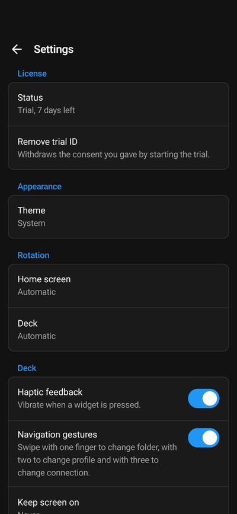

Open the settings with the gear on the Connections screen. Settings for a single computer are in its
[connection settings](/guide/companion-app/deck/#connection-settings) instead.

## License

| Setting | Does |
| --- | --- |
| Status | **Licensed**, **Trial** with the days left, **Trial ended**, **Trial starts when you connect to your computer** after starting it on the first start, or **Not licensed**. Tap it for the license details, such as the **License ID** support asks for. |
| Buy license, Restore purchase | Buy the license in the store, or get back one you bought with the same store account. Not shown in the Android version without Google Play services. |
| Remove trial ID | Withdraws the consent you gave by starting the trial. A trial that is running keeps running. |

See [License and trial](/guide/companion-app/license/).

## Appearance and rotation

| Setting | Does |
| --- | --- |
| Theme | **System**, **Light** or **Dark** for the app's own screens. The deck itself looks as it is set up in Macro Deck. |
| Home screen | Rotation of the Connections screen: automatic, portrait or landscape. |
| Deck | Rotation of every deck, unless a connection sets its own **Deck rotation**. |

## Language

The app has no language setting of its own. It follows the language of your device and speaks the same
languages as Macro Deck: Arabic, Brazilian Portuguese, Czech, Dutch, English, French, German, Hindi,
Indonesian, Italian, Japanese, Korean, Polish, Russian, Simplified Chinese, Spanish, Traditional Chinese,
Turkish and Ukrainian. Traditional Chinese is used for Taiwan, Hong Kong and Macau. For any other device
language the app is in English.

To use the app in another language than the device:

- **Android 13 or later:** open the system settings, **System**, **Languages**, **App languages** and choose Macro Deck.
- **iPhone and iPad:** open the system **Settings**, scroll down to Macro Deck and choose **Language**.
- **Older Android versions:** the app follows the device language.

In Arabic the app's screens read from right to left. Your decks never change direction: widgets stay
where you placed them, in every language.

The text inside a deck, such as the labels of widgets and plugins, comes from Macro Deck itself and
follows the language set there.

## Deck

| Setting | Does |
| --- | --- |
| Haptic feedback | Vibrates when you press a widget. On by default. |
| Fixed vibration length | Android only. Vibrates for a set time instead of the system's short click effects, for phones and tablets whose vibration motor cannot render those, so a press is not felt. Off by default. Like the normal haptics it follows the system's touch feedback setting, so it stays silent while touch feedback is off in Android's settings. |
| Vibration length | Android only, shown while **Fixed vibration length** is on. 20 to 200 ms in steps of 10, 80 ms by default. Letting go of the slider plays the new length once. Try a longer one if a press is still hard to feel. |
| Navigation gestures | Swipe with one finger to change folder, with two to change profile and with three to change computer. On by default. |
| Keep screen on | **Never**, **While a deck is open** or **Always**. **Never** is the default. The app warns about burn-in first: on OLED screens a deck that never changes can leave a permanent ghost image. A dark theme and lower brightness reduce the risk. |
| Dim when idle | Lowers the brightness after a while without a touch while a deck is open, which spares OLED screens and the battery. Off by default. A brightness your computer set comes back when it wakes. On iPhone and iPad it only ever dims, so a screen already darker stays as it is; on Android the app cannot read the system brightness, so in a dark room a dim level above it makes the screen brighter, and a low level is the better choice there. A touch, a key on Android, a notification from Macro Deck or the **Turn screen on** or **Bring to front** action wakes it at once. The system turns the screen off on its own after its auto-lock time, often before the deck dims, so set **Keep screen on** as well. On Android the dimming is the app's own and ends when you leave it; on iPhone and iPad it is the device's brightness, which the app puts back before Control Center, a call or the app switcher covers it, and on the next start if the app was stopped while dimmed. A finger held perfectly still counts as no touch. On iPhone and iPad keys and typing on the keyboard do not count, so they neither wake the screen nor keep it awake. |
| Dim after | Shown while **Dim when idle** is on. 30 seconds, 1, 2, 5, 10, 15 or 30 minutes without a touch, 2 minutes by default. |
| Dimmed brightness | Shown while **Dim when idle** is on. 5 to 50 % in steps of 5, 10 % by default. |
| First touch only wakes | Shown while **Dim when idle** is on. The touch that wakes a dimmed screen presses nothing, so you do not run an action you cannot see; it also closes a screensaver. On Android this holds for keys too, Back included, while the volume keys always work. On by default. |
| Icon resolution | The size deck icons are loaded in: **Automatic**, **128 px**, **256 px** or **512 px**. **Automatic** is the default and picks the size from how large each icon is drawn, so a phone usually gets 128 px and a tablet or a large widget 256 px or 512 px. A smaller size loads faster, a larger one looks sharper. With **Automatic** the row shows the sizes the deck you last opened used. Only icons change, not artwork such as album covers. A Macro Deck version without this feature always sends 256 px. |

## Device

**Device name** is the name this phone or tablet has in Macro Deck's **Settings > Devices** and in the device
list of automations. A computer shows the new name the next time this device signs in to it.

**Open after the device starts**, on Android only, opens the app by itself once the device has started or
restarted, and connects to the computers under **Connect on opening** as if you had opened it. Off by default.
From Android 10 it also needs **Display over other apps**; see
[Open after the device starts](/guide/companion-app/android/#open-after-the-device-starts).

## Connections

| Setting | Does |
| --- | --- |
| Find hosts on the network | Looks for Macro Deck on the local network and lists it under **Found on this network**. Without it, you add a computer by QR code or address. |
| Detect USB connection | Lets the app reach Macro Deck through a USB cable. See [Connect over USB](/guide/usb-connection/). |
| Connect on opening | The computers the app opens by itself when it starts, in order: it opens the first that answers. **USB connection** can be one of them. |

## Automation

| Setting | Does |
| --- | --- |
| Allow external automation | Lets other apps run your scripts with an Android intent or a run-script link. Off by default. |
| Automation key | The key every request has to carry. **Show**, **Copy key** and **Generate new key**, which shows the new key and stops every automation that uses the old key. |
| Scripts | Each computer's scripts with their IDs. Tap a script to copy its link or, on Android, its intent details, or to create a shortcut for it or add it to Quick Settings. |
| App icon menu | Android only: the scripts you added to the menu of the app icon, each with a button to remove it. Shown once there is one. |
| Quick Settings tiles | On Android, the scripts you put in the Quick Settings panel, shown once you added one. Each has **Run while the device is locked**, off by default, and can be removed here. |

See [Run scripts from other apps](/guide/companion-app/automation/).

## NFC tags

**NFC tags** lists the tags you set up, each opening a computer's deck, running a script, or both when tapped.
Add, edit, write, read, test and delete them there. See [NFC tags](/guide/companion-app/nfc-tags/).

## Only on Android: Device control

These let Macro Deck control the phone or tablet beyond the deck. Each one asks Android for a permission; see
[Android](/guide/companion-app/android/#device-control) for what each is for.

- **Background connection**
- **Unrestricted battery use**
- **Display over other apps**
- **Turn screen off**
- **Accessibility service**
- **Screen capture**
- **Wi-Fi name**

## Only on iPhone and iPad: Battery

While Low Power Mode is on, the settings say so: iOS then reduces performance and network activity, which can
slow a deck down. Turn Low Power Mode off in Control Center or under **Battery** in the Settings app.

## Feedback, About and Legal

- **Discord** and **GitHub Issues**: ask the community and report bugs.
- **Share diagnostics**: shares recent connection events and the addresses of your computers, for a bug report.
  If the app closed because of an error, it also contains the last crash: when it happened, the app version and
  where in the app it failed. The app keeps the last crash until a newer one replaces it, so open the app again
  after a crash and share the diagnostics from here. It never contains passwords or tokens.
- **About**: version, build and **Open source licenses**.
- **Legal**: imprint, privacy policy and terms of service.
