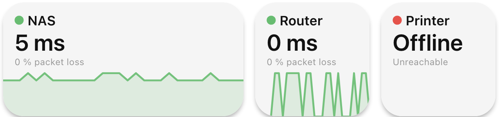

The Ping integration checks devices on your network the way the `ping` command does: a NAS, a server, a
router, a printer or anything else that answers ping. It shows whether each device is online and how fast it
answers, and it can run an action when a device goes offline or comes back.

## Adding a target

Open **Integrations**, choose **Ping** and add a configuration for every device you want to watch:

- **Configuration name**: how the device is called in triggers, widgets and variables, for example `NAS`.
- **Host**: the host name, IPv4 address or IPv6 address of the device, for example `192.168.1.10`,
  `nas.local` or `fd00::10`.
- **Interval (seconds)**: how often Macro Deck pings it, from 1 second to 1 hour. 10 seconds by default.
- **Timeout (milliseconds)**: how long Macro Deck waits for each reply, from 100 milliseconds to 10 seconds.
  It must be shorter than the interval. 1 second by default.
- **Failures before offline**: how many pings in a row must go unanswered before the device counts as
  offline, from 1 to 20. With the default of 3, a single lost packet does not make a device look offline.

Macro Deck does not ping the device while you add it, so you can add a device that is switched off right
now. When a host name has several addresses, for example an IPv6 and an IPv4 address, Macro Deck tries them
in turn and counts the device as online as soon as one of them answers.

The list of configurations shows for each target whether it is online.

## Triggers

Ping offers two events for automations and widget flows:

| Event | When |
| --- | --- |
| Target online | A target answers again after it was offline |
| Target offline | A target did not answer as many pings in a row as its **Failures before offline** |

Pick a **Target** to react to one device only, or leave it empty to react to all of them. The event carries
the target's host and, when it comes online, its latency in milliseconds.

The events fire only when a device really changes between online and offline. The first result after Macro
Deck starts or after you add a target fires no event, so starting Macro Deck does not run all your
"came online" actions at once. Renaming a target or changing its interval, timeout or failure count keeps
its state, so a device that comes back right after the change still fires **Target online**.

## The Ping status widget

Add the **Ping status** widget to a folder and choose in its settings:

- **Target**: the device it shows. When you leave it empty, it shows the first one.
- **Display name**: a name to show instead of the configuration name.
- Whether it shows the latency, the packet loss and the latency history.

The widget shows a green dot and the latency while the device answers, a red dot with **Offline** and the
reason, for example **No reply** or **Name not found**, once it counts as offline, and a grey dot while
Macro Deck waits for the first reply. With packet loss turned on, the line below the latency shows the
packet loss, 0 % included; turned off, it shows the status. The latency history is a line across the widget,
starting at 0 ms, that moves on every second like the **History Graph** and covers about the last 30 pings,
at most the last 10 minutes. While the device is offline it has no latency, so the line pauses.

For a longer history, add the built-in **History Graph** widget and choose the target's `…_latency`
variable.

## Variables

Each target gets its own variables, named after its configuration name, for example `ping_nas_online`.
Renaming a configuration renames its variables. The **Variables** page shows the exact names.

| Variable | Contains |
| --- | --- |
| `…_online` | Whether the target counts as online. Unavailable until Macro Deck has its first result |
| `…_latency` | The latency of the last reply in milliseconds. While a target is online but a few pings below its failure count went unanswered, this is still the last reply. Unavailable while the target is offline |
| `…_packet_loss` | The share of the last 20 pings that went unanswered, in percent |
| `…_last_seen` | When the target last answered, as an ISO 8601 time in UTC. Unavailable until it answered once |

## How often Macro Deck pings

Macro Deck pings each target once per interval, and every widget, trigger and variable of that target uses
the same result. Adding more widgets does not add pings. A host name is looked up again for every ping, so a
device that gets a new address is found again.

## When ping is not permitted

Some systems do not let apps send ping requests. Macro Deck then shows **Ping is not permitted** on the
**Integrations** page and **Ping not permitted** on the widget, and leaves the targets as they are instead of
reporting them as offline, so no **Target offline** action runs.

- **Linux**: allow ping without root for the group Macro Deck runs as, for example with
  `sudo sysctl net.ipv4.ping_group_range="0 2147483647"`, or install the `ping` command.
- **Windows** and **macOS** allow ping without extra settings.

On Linux the `ping` command can only wait in whole seconds, so a timeout below one second may be rounded up
there.
