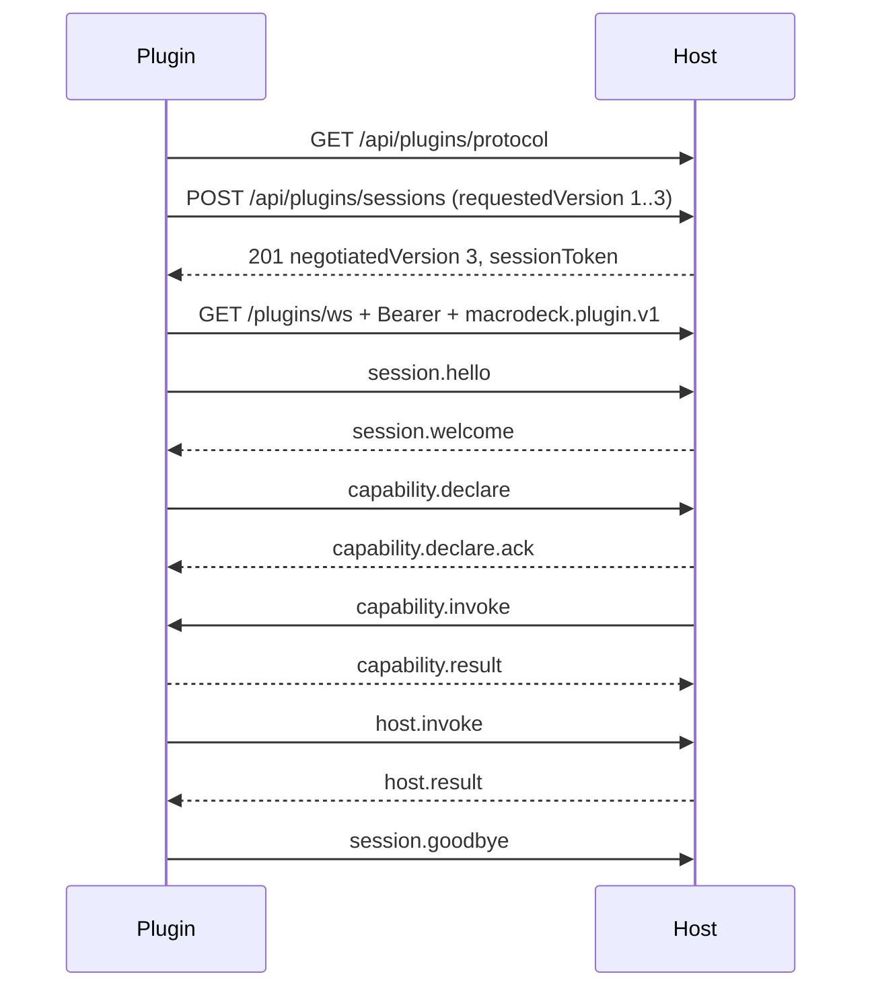

The plugin protocol is a versioned JSON contract over HTTP and WebSocket; implement it directly only when building another runtime or language binding - .NET plugins use `MacroDeck.Plugin.Hosting`.

The machine-readable contracts are authoritative for exact fields: the [OpenAPI spec](/specs/openapi.yaml)
(HTTP bootstrap, registration, sessions, the upgrade) and the [AsyncAPI spec](/specs/asyncapi.yaml)
(envelopes and payloads). The public DTOs and constants live in `MacroDeck.Plugin.Protocol`, which is
independent of the host assemblies. The message catalogue is in the [WebSocket reference](/reference/websocket/).

## At a glance



1. Read the descriptor.
2. Self-registering only: register once, through pairing or a Developer token. Managed plugins receive
   launch credentials instead. See [Authentication](/reference/authentication/) and
   [Plugin hosting](/reference/plugin-hosting/).
3. Exchange the credential for a short-lived session - **this is where the version is negotiated**.
4. Upgrade to `/plugins/ws` with the session token.
5. Send `session.hello`, wait for `session.welcome`.
6. Exchange capability and host-callback messages until the session ends.

## The envelope

```json
{
  "type": "session.hello",
  "id": "01a09528-bb98-798a-bd96-e46f5388cd89",
  "sentAt": "2026-09-12T10:27:49.784Z",
  "protocolVersion": 3,
  "payload": {
    "protocolVersion": 3,
    "sessionId": "01a09528-bb8e-7eb4-a4f0-0aa018202b2b",
    "instanceId": "01a09528-bb9d-7057-8d59-ff9a1d93885a"
  }
}
```

| Field | Type | Required | Notes |
| --- | --- | --- | --- |
| `type` | string | yes | `<domain>.<verb>` |
| `id` | string | yes | UUIDv7, minted by the sender |
| `correlationId` | string | no | The `id` this message answers |
| `sentAt` | string | no | RFC 3339 UTC, informational only |
| `protocolVersion` | integer | no | |
| `deadlineMs` | integer | no | |
| `idempotencyKey` | string | no | At most 128 characters |
| `payload` | object | no | Shaped by `type`; mutually exclusive with `error` |
| `error` | `ProtocolError` | no | See [Errors](#errors) |

Compatibility rules:

- Unknown optional fields are ignored on read and never echoed back.
- An unknown `type` gets `UNKNOWN_MESSAGE_TYPE` with the `id` preserved as `correlationId`, and **does
  not terminate the session**.
- Malformed input (unparseable, oversize, too deep, missing `type` or `id`) gets `MALFORMED_ENVELOPE`,
  never an unhandled parser exception, and does not close the socket either.
- Replies carry the request's `id` as `correlationId`. Correlation, cancellation and idempotency rules
  are in the [WebSocket reference](/reference/websocket/#correlation-and-response-pairing).

## Version negotiation

Request, in `POST /api/plugins/sessions`:

```json
{ "requestedVersion": { "minimum": 1, "maximum": 3 } }
```

Response:

```json
{ "negotiatedVersion": 3, "capabilities": [{ "kind": "actions", "accepted": true, "negotiatedVersion": 1 }] }
```

No overlap:

```http
HTTP/1.1 422 Unprocessable Entity
Content-Type: application/json

{ "code": "PROTOCOL_VERSION_UNSUPPORTED", "message": "The requested protocol version is not supported.", "details": { "supportedMinimum": "1", "supportedMaximum": "3" }, "retryable": false }
```

The version is a single integer major, not semver. Additive changes stay inside the current major;
breaking wire changes need a new major, with earlier majors still served. The host picks the highest
mutually supported version, once. `session.hello` only confirms it.

| Major | Change | Older plugins |
| --- | --- | --- |
| `1` | Baseline | - |
| `2` | `widgets` host-api payload only: a widget appearance change names the states it applies to by stable id, not the old fixed selector | Translated by the host |
| `3` | Descriptor text (action names, parameter labels, config-flow text) may be a `{"$localized":…}` reference instead of a plain string. Below `3` a plugin must send a plain string | Translated by the host |

- The subprotocol `macrodeck.plugin.v1` names the protocol **family**, not the major, and does not
  change between majors.
- Capability versions negotiate independently per kind. An unsupported capability comes back
  `accepted: false` with a `rejectionReason`, without rejecting the whole session.
- See the [migration guide](/policies/migrations/) and the [compatibility policy](/policies/compatibility/).

## The handshake

Captured against the CLI's stub host:

```json
{"type":"session.welcome","id":"01a09528-bb9d-7b67-9659-b7ec73280280","correlationId":"01a09528-bb98-798a-bd96-e46f5388cd89","payload":{"sessionId":"01a09528-bb8e-7eb4-a4f0-0aa018202b2b","resumed":false}}
```

The first message must be `session.hello` (see [the envelope](#the-envelope)) within the handshake
timeout (10 s). It carries no credential.

| `session.hello` field | Required | Meaning |
| --- | --- | --- |
| `protocolVersion` | yes | The negotiated version, asserted |
| `sessionId` | yes | The session from `POST /api/plugins/sessions` |
| `resumeSessionId` | no | Present when resuming a dropped session |
| `instanceId` | no | The connecting process instance, for logs |

| Outcome | Host response |
| --- | --- |
| Timeout, not `session.hello`, or malformed payload | `protocol.error` `INVALID_PAYLOAD`, normal close |
| Session unknown, or `sessionId` does not match the token | `SESSION_EXPIRED`, close `4002` |
| `protocolVersion` differs from the negotiated one | `PROTOCOL_VERSION_UNSUPPORTED`, close `4001` |
| Resume refused | `SESSION_NOT_RESUMABLE`, normal close |
| Success | `session.welcome` with `resumed` |

## Capability operations

```json
{ "type": "capability.invoke", "id": "<id>", "deadlineMs": 30000, "payload": { "…": "…" } }
```

```json
{ "type": "capability.result", "id": "<id>", "correlationId": "<invoke-id>", "payload": { "…": "…" } }
```

A plugin declares the capabilities it serves. The host invokes them with `capability.invoke`; the
plugin answers with `capability.result`, an error, or the cancellation path. The kinds a host supports
are listed in the descriptor's `capabilityKinds`:

`actions`, `events`, `variables`, `icons`, `config-flow`, `music-player`, `weather`,
`virtual-profiles`, `issues`, `ui`, `localization`, `device-provider`, `layout-provider`,
`folder-view-provider`, `migration`, `widget-type-provider`, `screensaver-provider`, `messaging`,
`video-stream-provider`, `calendar`, `config-entries`, `battery-provider`, `email-inbox`,
`companion-device-entries`.

- **Do not invent operation names inside an existing kind.** Additions to the operation vocabulary are
  compatibility-sensitive protocol changes. Exact operations and payloads are in the protocol package
  and AsyncAPI.
- `state.update` is an invalidation signal: the peer refreshes that capability's state. It is not a
  second per-capability diff protocol.
- `music-player` state gained `badge`, additively in major `1`. A plugin that does not send it shows no
  badge, and a host that predates it skips the field.
- `actions` gained `state`, additively in major `1`, for actions that supply an Action Button's states.
  It is keyed by the action's configured parameters, so the host **polls** it: `state.update` is keyed
  by the declared capability id (the action type) and cannot name which configured instance changed.
- `actions` also gained `icon` and `icon.content`, the same way, for an action whose configured instance
  supplies a widget's icon (`ActionDescriptorDto.ProvidesIcon`). `icon` is polled like `state` and
  answers an identity, not bytes; `icon.content` fetches the bytes only when that identity changes,
  uploaded over the `asset.*` pipeline, never inside the capability reply. The `widgets` host API's
  `invalidate-icon` asks the host to re-read an action sooner than its next poll.
- `ActionDescriptorDto` gained the optional `role` (`IActionDefinition.Role`) and `VariableDefinitionDto`
  the optional `isShareable` (`VariableDefinition.IsShareable`), additively in major `3` and within each
  kind's capability version. An absent `role` means no role and an absent `isShareable` means `true`,
  which is what a plugin built before them sends; an older host ignores both.
- `ActionDescriptorDto` gained the optional `riskCategory` (`IActionDefinition.RiskCategory` as its
  lower-case name: `scripts`, `programs`, `input`, `network`, `files`, `power`), additively in major `3`
  and within capability version `1`. An absent or unknown value means none, which is what a plugin built
  before it sends; an older host ignores it.
- `actions` `execute` arguments gained the optional `scriptId` and `automationId`
  (`ActionExecutionContext.ScriptId` and `AutomationId`), additively in major `3` and within capability
  version `1`. A host that predates them leaves them out, which a plugin reads as a step outside a script
  or automation; an older plugin ignores them.
- `calendar` was added as a new kind at capability version `1`, additively in major `3`. A host that
  predates it rejects the declaration non-fatally (`accepted: false`) and the session goes on without it.
  Its operations and reply limits are in the [WebSocket reference](/reference/websocket/#calendar).
- `config-entries` was added as a new kind at capability version `1`, additively in major `3`, for a
  plugin taking part in how the host stores its configuration entries. A host that predates it rejects the
  declaration non-fatally and stores entries as it always did. See the
  [WebSocket reference](/reference/websocket/#config-entries). Its `prepare` later gained the optional
  `rejectedVariableNames` argument and `retryOnConflict` result field, and a `config-flow` `Complete` result
  the optional `withoutEntry` flag, all within capability version `1`: a peer that predates them leaves them
  out and the other side behaves as before.
- `battery-provider` was added as a new kind at capability version `1`, additively in major `3`, together
  with the `batteries` host API. Its only operation is `describe`; devices travel the other way - see
  [`batteries`](/reference/websocket/#batteries) and [Batteries](/features/batteries/).
- `email-inbox` was added as a new kind at capability version `1`, additively in major `3`. A host that
  predates it rejects the declaration non-fatally and the session goes on without it. For this kind only,
  `state.update` with a `localId` names an inbox, not a declared capability: that inbox's content or status
  changed, and the host reads its `snapshot` again instead of re-describing the kind. Its operations and
  reply limits are in the [WebSocket reference](/reference/websocket/#email-inbox).
- `companion-device-entries` was added as a new kind at capability version `1`, additively in major `3`. It
  is declarative: declaring it asks the host to keep one configuration entry of the plugin per Companion
  device, and its only operation, `describe`, answers without data. A host that predates it rejects the
  declaration non-fatally. See [Companion devices](/features/companion-devices/#a-configuration-entry-per-device).

- `ui` `describe` gained the optional `pages`, additively in major `3` and within capability version `1`:
  the [integration pages](/ui/views/page/) the plugin declares, each with `id`, `title` and an optional
  `iconName`. The host keeps them only when `surfaces` also declares the `page` kind, and drops a page whose
  `id` is not a letter or digit followed by up to 63 letters, digits, hyphens or underscores, or repeats an
  earlier one. A plugin built against an SDK that predates pages omits the member, which reads as none; a
  host that predates them ignores it. The host then opens a `page` surface with the `integrationId`,
  `pageId` and `culture` attributes, from an administrator's desktop app only.

See [capabilities](/features/) and [Capability parity](/reference/capability-parity/).

## Host callbacks

```json
{ "type": "host.invoke", "id": "<id>", "payload": { "…": "…" } }
```

```json
{ "type": "host.result", "id": "<id>", "correlationId": "<host-invoke-id>", "payload": { "…": "…" } }
```

Plugins call host-owned APIs with `host.invoke` and cancel with `host.cancel`. `MacroDeck.Plugin.Hosting`
maps these to `IIntegrationContext`. Some synchronous-looking SDK state is served from the last
`host.state` snapshot, so check [Capability parity](/reference/capability-parity/) before assuming
in-process timing.

`variables` gained `refresh`, `history.open`, `history.read`, `history.close` and `bind`, `widgets` gained
`get-data`, `ui` gained `origin.report-failure`, `origin.show-modal` and `report-parameter-values`, and the
`weather` api with `snapshots-changed` was added, additively in major `3`. A host
that predates them answers `CAPABILITY_UNSUPPORTED`, which `MacroDeck.Plugin.Hosting` turns into a no-op,
`false`, no widget data, an unsupported variable history, a `NotSupportedException` for bindings or a
cancellation. `refresh` later gained an optional `definitionIds` argument, which a host that predates it
ignores, reading every declared variable instead. A newer host also reads the bound catalog resources a
`definitionIds` list names; an older one leaves them on their refresh interval.
`ui` later gained `origin.open-url`, additively in major `3`. A host that predates it answers
`CAPABILITY_UNSUPPORTED`, which `MacroDeck.Plugin.Hosting` turns into `false`, the same answer a client that
cannot open links gets; see
[Opening a link on the client that pressed](/ui/views/sessions/#opening-a-link-on-the-client-that-pressed).

The `user-variables` `apply` and `create` arguments gained the optional `scriptId` and `automationId`
next to `ownerWidgetId`, additively in major `3`, behind `IUserVariableApi.ApplyInContextAsync` and
`CreateInContextAsync`. A host that predates them ignores them and resolves by `ownerWidgetId` alone, and an
older plugin never sends them. `create` can answer the new statuses `UnknownScript` and `UnknownAutomation`.
See [Scopes](/features/variables/#scopes).

`user-variables` later gained `read`, additively in major `3`, behind `IUserVariableApi.ReadInContextAsync`.
It reads a variable the way `{{ vars.<name> }}` resolves it for a flow in the given context: script local,
then automation local, then widget local, then global; integration and widget variables by name; script
inputs excluded. Its arguments are `name` (required) and the optional `ownerWidgetId`, `scriptId` and
`automationId`. It answers `status` (`Found`, `NotFound`, `InvalidName`, `NotSupported` or `Unavailable`),
`type` (the variable type's member name, set when found and when unavailable), `value` (a JSON string,
number or boolean by type, when found), `text` (the value as a template renders it) and `message`
(diagnostic). The host never caches the answer. A host that predates it answers `CAPABILITY_UNSUPPORTED`,
which `MacroDeck.Plugin.Hosting` reports as `NotSupported`; a transport failure or an empty reply is
reported as `Unavailable`.

<a id="ui-uploads"></a>`ui` later gained `origin.read-upload`, additively in major `3`. A
[code input](/ui/views/configuration/#code-input) whose text is a content resource uploads its edits to the
host over HTTP and raises `content-uploaded` with an `uploadId`; the plugin then reads the bytes with
`origin.read-upload` (`sessionId`, `uploadId`). The host answers `found`, and when `true` also
`byteLength`, `contentHash` and `transferId`, and sends the bytes over `host.asset.*` as kind `ui-upload`
under that `transferId`. It answers `found: false` alike for an unknown, expired or replaced upload and for
a session the calling plugin does not serve, so a plugin can never read another's uploads. A host that
predates it answers `CAPABILITY_UNSUPPORTED`, which `MacroDeck.Plugin.Hosting` turns into
`NotSupportedException`; a `found: false` becomes `UiUploadNotFoundException`.

The `locale` host API (`time-of-day-format`) and the push-only `http` host API were added the same way. A
host that predates `locale` answers `CAPABILITY_UNSUPPORTED`, which `MacroDeck.Plugin.Hosting` turns into the
plugin's current culture with a 24-hour clock; a host that predates `http` pushes nothing, so the SDK reports
its default User-Agent. Integration storage is not a host API: the SDK keeps it in the plugin's own data
directory.

The `deck` snapshot carries `folders`, `profiles`, `clients` and `revision`. Each entry in `clients` is one
connected client with `clientId`, `deviceId` (absent for a client that is not a paired device), `profileId`
and `folderId`. `revision` increases with every `deck` push within one host run and starts again when the
host restarts; hosts that predate it omit both fields, which read as an empty list and 0. `deck` pushes can
arrive out of order, so apply one only when its revision is higher than the last one applied in this
session, always apply revision 0, and reset the last applied revision when a session is not resumed.

The `adb` snapshot, pushed per plugin, follows the same revision rule. It is one of the three host APIs a
plugin may be refused by its manifest: see [the WebSocket reference](/reference/websocket/#adb).

The `companion-devices` host API (`wait`, `send`, `request`, `screenshot`) is another, gated by
`host:companion-devices` and the user's consent, and was added additively in major `3` with its own per-plugin
snapshot under the same revision rule. A host that predates it answers `CAPABILITY_UNSUPPORTED` and pushes
nothing, which `MacroDeck.Plugin.Hosting` reports as access `Unsupported`, a send that answers `false` and a
request or screenshot that fails as not connected; an older plugin ignores the push. See
[`companion-devices`](/reference/websocket/#companion-devices) and
[Companion devices](/features/companion-devices/).

The `desktop-notifications` host API (`show`) is the third, gated by `host:desktop-notifications` alone, and
was added additively in major `3` with a per-plugin push, sent on registration, of whether the plugin may
show notifications from the operating system. A host that predates it answers `CAPABILITY_UNSUPPORTED` and
pushes nothing, which `MacroDeck.Plugin.Hosting` reports as `IsSupported` `false` and a `ShowAsync` that
shows nothing; an older plugin ignores the push. See
[`desktop-notifications`](/reference/websocket/#desktop-notifications) and
[Desktop notifications](/features/notifications/#desktop-notifications).

The `music-players` host API (`album-color`) was added the same way, with a snapshot of every provider's
players that every plugin receives under the same revision rule. It is not gated. A host that predates it
answers `CAPABILITY_UNSUPPORTED` and pushes nothing, which `MacroDeck.Plugin.Hosting` reports as no players
and no colour; an older plugin ignores the push. See [`music-players`](/reference/websocket/#music-players).

A callback can return bytes: an icon from the `devices` api's `icon` operation, a widget's rendered
action icon from its `widget-icon` operation, an Android screenshot from the `adb` api's `screenshot`
operation, a Companion device's screenshot from the `companion-devices` api's `screenshot` operation, or
the text a code input uploaded from the `ui` api's `origin.read-upload` operation. These travel over `host.asset.*`, a host-to-plugin
pipeline kept separate from the plugin-to-host `asset.*` types so those keep their major-1 direction.
See [the WebSocket reference](/reference/websocket/#assets).

## Errors

```json
{
  "type": "protocol.error",
  "id": "<id>",
  "correlationId": "<id-of-the-offending-message>",
  "error": { "code": "UNKNOWN_MESSAGE_TYPE", "message": "The message type is not recognised.", "retryable": false }
}
```

On HTTP the same `ProtocolError` object is the whole response body. Protocol failures (malformed input,
unsupported operations or capabilities, authentication, timeouts, cancellation, backpressure) are
protocol outcomes with stable codes, not transport exceptions. `message` is a default English string
keyed by `code`; localise from the code. `details` is a string-to-string map, at most 16 entries.

| Code | Default message |
| --- | --- |
| `PROTOCOL_VERSION_UNSUPPORTED` | The requested protocol version is not supported. |
| `UNKNOWN_MESSAGE_TYPE` | The message type is not recognised. |
| `MALFORMED_ENVELOPE` | The message envelope could not be parsed. |
| `INVALID_PAYLOAD` | The message payload does not match the expected shape. |
| `UNAUTHENTICATED` | Authentication failed. |
| `PLUGIN_ALREADY_REGISTERED` | A plugin is already registered with this identity. |
| `SESSION_EXPIRED` | The session has expired. |
| `SESSION_NOT_RESUMABLE` | The session can no longer be resumed. |
| `SESSION_REPLACED` | The session was replaced by a newer connection. |
| `SESSION_NOT_FOUND` | No session matches that id. |
| `CAPABILITY_UNSUPPORTED` | The capability kind is not supported. |
| `CAPABILITY_UNAVAILABLE` | The capability is not currently available. |
| `PAYLOAD_TOO_LARGE` | The message payload exceeds the allowed size. |
| `ASSET_TOO_LARGE` | The asset exceeds the allowed size. |
| `QUEUE_OVERFLOW` | The message queue overflowed. |
| `RATE_LIMITED` | Too many requests; retry after the given delay. |
| `TIMEOUT` | The operation timed out. |
| `CANCELLED` | The operation was cancelled. |
| `CORRELATION_UNKNOWN` | No in-flight message matches this correlation id. |
| `DUPLICATE_IDEMPOTENCY_KEY` | This idempotency key is already in flight. |
| `INTERNAL_ERROR` | An internal error occurred. |
| `ADB_NOT_ENABLED` | ADB is not enabled in Macro Deck. |
| `ADB_NOT_ALLOWED` | This plugin is not allowed to use ADB. |
| `ADB_FAILED` | The ADB operation failed. |
| `UI_RESOURCE_QUOTA_EXCEEDED` | The plugin's UI resource quota is exhausted. |
| `PLUGIN_ICON_NOT_FOUND` | The plugin's bundled icon packs contain no such icon. |
| `ICON_PACK_INVALID` | The icon pack archive is not usable. |
| `ICON_PACK_SYNC_NOT_ALLOWED` | Only a self-registered development session can sync bundled icon packs. |
| `ICON_NOT_FOUND` | No installed icon pack contains an icon with this id. |
| `COMPANION_DEVICES_NOT_ALLOWED` | This plugin is not allowed to use Companion devices. |
| `DESKTOP_NOTIFICATIONS_NOT_ALLOWED` | This plugin is not allowed to show desktop notifications. |

The list is append-only within a major. The three `ADB_*` codes answer only the `adb` host API, and
`COMPANION_DEVICES_NOT_ALLOWED` only the `companion-devices` host API, and
`DESKTOP_NOTIFICATIONS_NOT_ALLOWED` only the `desktop-notifications` host API; see
[the WebSocket reference](/reference/websocket/#adb). A `reason` in `details` refines a deliberately generic
code, for example `developer_mode_disabled`, `host_locked`, one of the `adb_` reasons of `ADB_FAILED`, or
one of the `video_stream_` reasons of `CAPABILITY_UNAVAILABLE` (see
[`video-streams`](/reference/websocket/#video-streams));
the values are in
[`ProtocolErrorReasons.cs`](https://github.com/Macro-Deck-App/Macro-Deck/blob/main/protocol/src/MacroDeck.Plugin.Protocol/Errors/ProtocolErrorReasons.cs).
A client that does not recognise a reason handles the code alone.

Closing the socket is reserved for seven conditions; everything else is a `protocol.error` on an open
socket:

| Close | Condition | .NET SDK |
| --- | --- | --- |
| `1013` | `QUEUE_OVERFLOW` (RFC 6455 "Try Again Later") | Reconnects |
| `4000` | `SESSION_REPLACED` | Stops |
| `4001` | `PROTOCOL_VERSION_UNSUPPORTED` | Stops |
| `4002` | `SESSION_EXPIRED` | Opens a new session |
| `4003` | Authentication failed | New session, up to `MaxAuthenticationFailures`, then stops |
| `4004` | Supervisor is stopping a managed plugin - nothing failed | Stops |
| `4005` | Declared capabilities rejected (invalid or duplicated ids, colliding integration id). Terminal: fix the declaration | Stops |

## Delivery and retries

Delivery is **at-most-once**. There are no sequence numbers and no replay log for messages lost during
a disconnect; do not expect the host to replay an unacknowledged event after reconnecting. For a
retryable operation that must not run twice, send an `idempotencyKey`: a repeat while the original is in
flight gets `DUPLICATE_IDEMPOTENCY_KEY`, a repeat after completion gets the cached result. A cancelled
invocation caches nothing, so a retry with its key runs again; an invocation that finished despite the
cancel keeps its result, so a retry replays it instead of running twice.

## Limits

```json
{ "maxMessageBytes": 262144, "maxInboundQueueDepth": 256, "queueHighWatermark": 192, "queueLowWatermark": 64, "maxConcurrentInvocations": 32, "maxSessionsPerPlugin": 1 }
```

Message size, queue depth, concurrency, timeouts and asset sizes are published in the descriptor and
again in the session response (`limits`, `timeouts`). Read them at runtime; do not copy the numbers into
plugin logic. The full current table is in the [WebSocket reference](/reference/websocket/#limits-and-timeouts).
A message over `maxMessageBytes` is `MALFORMED_ENVELOPE`; a payload over a specific cap (UI tree, asset)
is `PAYLOAD_TOO_LARGE` or `ASSET_TOO_LARGE`.

## Backpressure

Sent by the host when its inbound queue reaches the high watermark (192), and lifted at the low
watermark (64):

```json
{ "type": "flow.pause", "id": "<id>", "payload": { "reason": "The host's inbound queue is filling." } }
```

```json
{ "type": "flow.resume", "id": "<id>", "payload": { "reason": "The host's inbound queue has drained." } }
```

| Field | Required | Meaning |
| --- | --- | --- |
| `reason` | yes | Diagnostic text |
| `resumeAfterMs` | no | Hint for when to try again |

While paused, send only the exempt types (replies, pings, cancels, `host.*` calls, errors - the full
list is in the [WebSocket reference](/reference/websocket/#backpressure)). A peer that keeps sending
past `maxInboundQueueDepth` gets one `QUEUE_OVERFLOW` and a `1013` close. Use bounded concurrency and
honour cancellation.

## Reconnection and resume

```json
{ "type": "session.hello", "id": "<id>", "payload": { "protocolVersion": 3, "sessionId": "<session-id>", "resumeSessionId": "<session-id>", "instanceId": "<instance-id>" } }
```

```json
{ "type": "session.welcome", "id": "<id>", "correlationId": "<hello-id>", "payload": { "sessionId": "<session-id>", "resumed": true } }
```

| Situation | Result |
| --- | --- |
| New connection with `resumeSessionId`, inside the 60 s window, session still exists | Resume: `resumed: true` |
| Same, but outside the window or the session is gone | `SESSION_NOT_RESUMABLE` - open a new session |
| The host no longer knows the session at all, for example after a restart, or the token expired | The upgrade is refused with `401` before any hello - open a new session |
| New session for a plugin that already has one (`maxSessionsPerPlugin` is 1) | The old connection is closed with `4000` |
| `session.goodbye` or `DELETE /api/plugins/sessions/{sessionId}` | Session non-resumable at once |
| No inbound traffic for 60 s (host pings every 20 s) | Host aborts the socket |

A resume keeps the session id, negotiated version, capability map, declared catalogue and the plugin-side
idempotency cache. It drops in-flight invocations (a retry of one with its idempotency key runs
again), event subscriptions and queued outbound messages. A fresh session after expiry is not a resume
and may need capability state and lifecycle re-initialisation. Reconnect with full-jitter exponential backoff: 1 s initial, 30 s maximum, factor 2.
`MacroDeck.Plugin.Hosting` does all of this for .NET plugins.

## Security

Plugin endpoints need plugin-specific credentials and accept only local callers. Browser cookies are
not a plugin WebSocket authentication mechanism. Never log plugin secrets, session tokens, enrolment
credentials, OAuth credentials or authorisation headers. See [Security](/policies/security/) and
[Authentication](/reference/authentication/).

## SDK compatibility metadata

```json
{ "sdk": { "sdkVersion": "3.0.0", "deprecatedApis": [], "truncated": false } }
```

Sent in `POST /api/plugins/sessions`. `deprecatedApis: null` means "not reported"; `[]` means "reported,
none used". The host can return a `compatibility` report without making older plugins unable to
deserialise the session response. See [Deprecations](/policies/deprecations/).

## Implementing the protocol yourself

The specs and `MacroDeck.Plugin.Protocol` are the source of truth; this page does not duplicate every
field, timeout, operation or message type. Test at least negotiation, authentication, unknown-message
tolerance, cancellation, idempotency and retry, reconnect and resume, backpressure, and capability
payload compatibility. The [conformance suite](/reference/conformance/) runs these against a plugin.

## See also

- [WebSocket reference](/reference/websocket/) - every message type and payload.
- [Authentication](/reference/authentication/) - credentials and the session token.
- [Plugin hosting](/reference/plugin-hosting/)
- [Capability parity](/reference/capability-parity/)
- [Manifest](/reference/manifest/)
- [Conformance suite](/reference/conformance/)
- [Compatibility policy](/policies/compatibility/)
