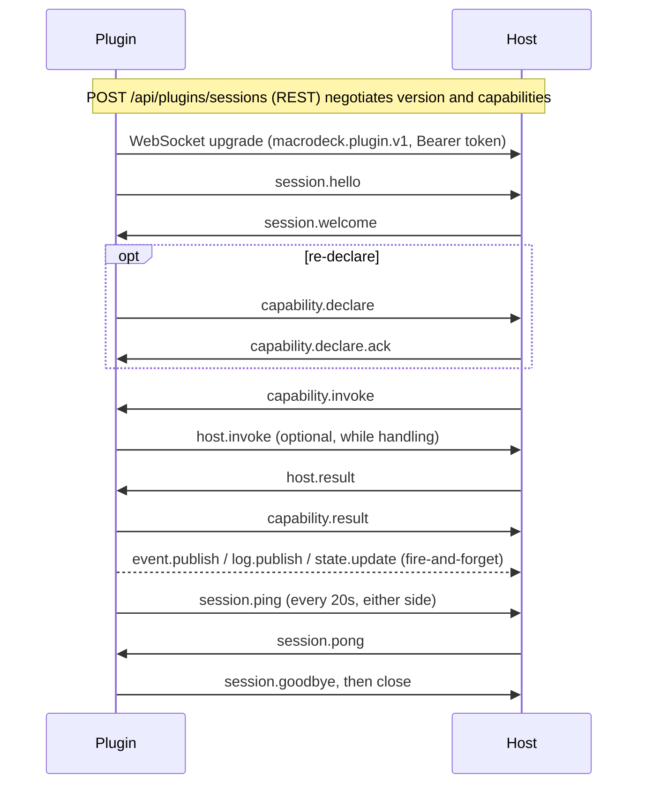

Every message on the plugin WebSocket, with a real frame for each; the narrative lives on [the protocol page](/reference/protocol/), the machine-readable contract in [asyncapi.yaml](/specs/asyncapi.yaml) (AsyncAPI 3.0.0), and the C# types in [`protocol/src/MacroDeck.Plugin.Protocol/`](https://github.com/Macro-Deck-App/Macro-Deck/blob/main/protocol/src/MacroDeck.Plugin.Protocol/), kept in step by drift tests.

## At a glance

```http
GET /plugins/ws HTTP/1.1
Upgrade: websocket
Sec-WebSocket-Protocol: macrodeck.plugin.v1
Authorization: Bearer <session-token>
```



The frames on this page were captured from the .NET SDK talking to the `MacroDeck.Plugin.Testing` stub host, except where a section says the example is built from the schema.

## Connecting

| | |
| --- | --- |
| Path | `/plugins/ws`, loopback remote addresses only |
| Subprotocol | `macrodeck.plugin.v1`, offered through `Sec-WebSocket-Protocol` - required |
| Authentication | `Authorization: Bearer <sessionToken>`, scope `plugin`, checked before the upgrade is accepted |
| Encoding | JSON, camelCase, `application/json` |

See [authentication](/reference/authentication/) for how the session token is obtained.

## The envelope

```json
{
  "type": "host.invoke",
  "id": "01a09528-bc61-7dea-be36-6c143daa1395",
  "sentAt": "2026-09-12T10:27:49.98595+00:00",
  "protocolVersion": 3,
  "deadlineMs": 30000,
  "payload": { "api": "variables", "operation": "list" }
}
```

Every message, in either direction, is one `ProtocolEnvelope`.

| Field | Type | Required | Meaning |
| --- | --- | --- | --- |
| `type` | string | yes | `<domain>.<verb>`, e.g. `capability.invoke`. |
| `id` | string | yes | UUIDv7, minted by the sender. |
| `correlationId` | string | no | The `id` of the message this one answers. |
| `sentAt` | string | no | RFC 3339 UTC; **informational only**, clocks differ between the processes. |
| `protocolVersion` | integer | no | The sender's protocol version. |
| `deadlineMs` | integer | no | The request deadline. |
| `idempotencyKey` | string | no | At most 128 characters, scoped to `(sessionId, key)`. |
| `payload` | object | no | Shaped by `type`. |
| `error` | `ProtocolError` | no | Set instead of `payload` on failure. |

- `payload` and `error` are **mutually exclusive**.
- Unknown optional fields are ignored on read and never echoed back - there is no extension-data slot.
- Deadline, idempotency key and correlation live on the envelope only; no payload repeats them.
- Strict serialisation: camelCase, case-sensitive, no comments, no trailing commas. A number sent as a string (`"deadlineMs": "30000"`) is a hard failure. Maximum nesting depth is `maxJsonDepth` (32).

### `ProtocolError`

```json
{
  "type": "capability.result",
  "id": "01a09528-bc76-73cb-9d15-b0dc9c05eada",
  "correlationId": "01a09528-bc76-758e-a190-263c3254b26f",
  "protocolVersion": 3,
  "error": {
    "code": "CAPABILITY_UNAVAILABLE",
    "message": "No action 'does-not-exist' is registered in this plugin.",
    "details": {},
    "retryable": false
  }
}
```

| Field | Type | Required | Meaning |
| --- | --- | --- | --- |
| `code` | string | yes | Stable error code - see [Error handling](#error-handling). |
| `message` | string | yes | Default English text keyed by `code`, **not copy to render**; localise from the code. |
| `details` | map of string to string | no | Extra diagnostic context. |
| `retryable` | boolean | yes | Whether retrying can succeed. |

## Message catalogue

Twenty-eight message types. Direction is enforced by the transport: a message arriving from the wrong side is rejected.

| Family | Types |
| --- | --- |
| [Session](#session) | `session.hello`, `session.welcome`, `session.goodbye`, `session.ping`, `session.pong` |
| [Capabilities](#capabilities) | `capability.declare`, `capability.declare.ack`, `capability.invoke`, `capability.result`, `capability.cancel` |
| [Host callbacks](#host-callbacks) | `host.invoke`, `host.result`, `host.cancel`, `host.state` |
| [Events, logs and state](#events-logs-and-state) | `event.publish`, `log.publish`, `state.update` |
| [Assets](#assets) | `asset.begin`, `asset.chunk`, `asset.commit`, `asset.ack`, `host.asset.begin`, `host.asset.chunk`, `host.asset.commit`, `host.asset.ack` |
| [Flow control and errors](#flow-control-and-errors) | `flow.pause`, `flow.resume`, `protocol.error` |

### Session

```json
{"type":"session.hello","id":"01a09528-bc4b-7500-8673-1df7313e68c9","protocolVersion":3,
 "payload":{"protocolVersion":3,"sessionId":"01a09528-bc42-7dc7-bf63-3d18ff4880c9","instanceId":"54292"}}
```

```json
{"type":"session.welcome","id":"01a09528-bc53-7099-817f-88ae70b8c334",
 "correlationId":"01a09528-bc4b-7500-8673-1df7313e68c9",
 "payload":{"sessionId":"01a09528-bc42-7dc7-bf63-3d18ff4880c9","resumed":false}}
```

| Type | Direction | Payload |
| --- | --- | --- |
| `session.hello` | plugin → host | `protocolVersion` (int, required), `sessionId` (required), `resumeSessionId`, `instanceId` |
| `session.welcome` | host → plugin | `sessionId` (required), `resumed` (bool, required) |
| `session.goodbye` | both | `reason` |
| `session.ping` | both | none - `payload` is omitted; an empty object is also valid |
| `session.pong` | both | none - `payload` is omitted; an empty object is also valid |

- `session.hello` asserts the version and session id already negotiated over REST; it never re-negotiates. A mismatch is `PROTOCOL_VERSION_UNSUPPORTED` and closes with `4001`.
- `resumeSessionId` distinguishes a resume from a replacement: presented inside the resume window, the session resumes; absent, the new connection **replaces** the prior session, which is closed with `4000`.
- `session.goodbye` is voluntary teardown and makes the session non-resumable at once. A plugin sends it to end its own session; the host sends it to a managed plugin the supervisor is stopping, immediately before a `4004` close.
- Either side may send `session.ping`; the reply is a `session.pong` correlated to it. Interval 20s, timeout 60s.

```json
{"type":"session.pong","id":"01a09529-55ae-752b-98d2-983ca3e8d859",
 "correlationId":"01a09528-c000-7000-8000-000000000001","protocolVersion":3}
```

### Capabilities

```json
{"type":"capability.invoke","id":"01a09528-bc6e-7610-94f6-f7a6d537ad16",
 "payload":{"kind":"variables","localId":"temperature","operation":"get"}}
```

```json
{"type":"capability.result","id":"01a09528-bc71-789e-bcff-8de629047430",
 "correlationId":"01a09528-bc6e-7610-94f6-f7a6d537ad16","protocolVersion":3,
 "payload":{"data":{"value":{"kind":"number","number":21.5}}}}
```

| Type | Direction | Payload |
| --- | --- | --- |
| `capability.declare` | plugin → host | `capabilities` (array of `DeclaredCapability`, required, ≤ 512 items) |
| `capability.declare.ack` | host → plugin | `capabilities` (array of `CapabilityNegotiationResult`, required) |
| `capability.invoke` | host → plugin | `kind`, `localId`, `operation` (all required), `arguments` |
| `capability.result` | plugin → host | `data` - the **success value only**; a failure sets the envelope's `error` instead |
| `capability.cancel` | host → plugin | `reason` - best-effort, see [Correlation](#correlation-and-response-pairing) |

Capabilities are first declared on the `POST /api/plugins/sessions` request; `capability.declare` re-declares on the open socket. It is **complete, not a delta**: it replaces what the session knows. Built from the schema:

```json
{"type":"capability.declare","id":"<uuid-v7>",
 "payload":{"capabilities":[
   {"kind":"actions","localId":"toggle-light","versionRange":{"minimum":1,"maximum":1},"displayName":"Toggle light"},
   {"kind":"weather","localId":"provider","versionRange":{"minimum":1,"maximum":1}}]}}
```

```json
{"type":"capability.declare.ack","id":"<uuid-v7>","correlationId":"<declare id>",
 "payload":{"capabilities":[
   {"kind":"actions","accepted":true,"negotiatedVersion":1},
   {"kind":"weather","accepted":false,"rejectionReason":"<reason>"}]}}
```

| Shape | Field | Type | Required | Meaning |
| --- | --- | --- | --- | --- |
| `DeclaredCapability` | `kind` | string | yes | One of the twenty-four kinds below. |
| | `localId` | string | yes | The capability's id within the plugin. |
| | `versionRange` | `{minimum, maximum}` | yes | Integer capability versions the plugin serves. |
| | `displayName` | string | no | Human-readable name. |
| `CapabilityNegotiationResult` | `kind` | string | yes | The kind negotiated. |
| | `accepted` | boolean | yes | Whether the session will use it. `variables` can also be used without being declared, see below. |
| | `negotiatedVersion` | integer | no | The agreed capability version. |
| | `rejectionReason` | string | no | Why it was rejected. |

Negotiation fails **non-fatally**: an unsupported or unknown kind comes back rejected with a reason, and the session proceeds degraded.

One kind is used without being negotiated: when a session declared no `variables` capability, the host still sends `variables`/`describe` while it registers the plugin (with a 5 second deadline), because a provider with only a catalog or only on-demand variables has nothing to declare. When the answer carries variables or a catalog, the session uses `variables` from then on. A plugin without the capability answers `CAPABILITY_UNSUPPORTED`, as for any kind it does not implement. A `variables` capability that was declared and rejected stays unused.

The twenty-four `kind` values: `actions`, `events`, `variables`, `icons`, `config-flow`, `music-player`, `weather`, `virtual-profiles`, `issues`, `ui`, `localization`, `device-provider`, `layout-provider`, `folder-view-provider`, `migration`, `widget-type-provider`, `screensaver-provider`, `messaging`, `video-stream-provider`, `calendar`, `config-entries`, `battery-provider`, `email-inbox`, `companion-device-entries`. `operation` comes from a fixed vocabulary per kind - see [capability operations](/reference/protocol/#capability-operations). Two more captured invokes:

```json
{"type":"capability.invoke","id":"01a09528-bc57-7b85-bed4-952327ffedcd",
 "payload":{"kind":"actions","localId":"toggle-light","operation":"execute","arguments":{"parameters":{}}}}
```

```json
{"type":"capability.result","id":"01a09528-bc76-7445-bb11-c953c477af93",
 "correlationId":"01a09528-bc72-7432-bc32-be05ca2bbbf3","protocolVersion":3,
 "payload":{"data":{"providerName":"com.example.lights","hasDynamicEventOptions":false,
   "events":[{"localId":"light-toggled","name":"Light toggled","deliveryKind":"Push",
     "configurationParameters":[],"payloadParameters":[]}]}}}
```

#### `localization`

Hands the plugin's own strings to the host instead of baking resolved text into its UI. Both operations are `capability.invoke`.

| Operation | Arguments | Result | Meaning |
| --- | --- | --- | --- |
| `describe` | none | `scope`, `defaultCulture`, `cultures` | Declares the plugin's scope (`plugin:<plugin-id>`) and shipped cultures, so the host can reject a plugin claiming a scope it does not own. |
| `catalog` | `culture` | `culture`, `entries` (key to template) | One culture's strings; nothing for that culture is an empty map, not a failure - the host's fallback chain decides. |

The host asks for one culture at a time (bounded per culture, not across them). Bounded by `maxLocalizationCultures`, `maxLocalizationEntries`, `maxLocalizationKeyLength`, `maxLocalizationValueLength`. See [Localization](/features/localization/) and `MacroDeck.Plugin.Protocol.Capabilities.Localization`.

#### `variables`

The only kind that is **item-shaped and provider-shaped at once**. The eager half declares one capability per variable at that variable's local id, as `actions` does; the catalog half declares nothing and carries resource ids in each operation's arguments, keeping large providers under `maxDeclaredCapabilities`.

| Operation | Arguments | Result | Meaning |
| --- | --- | --- | --- |
| `describe` | none | `variables`, `declaredVariables`, `variablesDependOnConfiguration`, `supportsCatalog`, `supportsPush`, `supportsSearch`, `catalogName` | Eager definitions and whether a catalog is also served. |
| `get` | none | `value`, `min`, `max`, `step` | One variable's value and volatile attributes, or unavailable. |
| `set` | `value` | `status`, `message` | Applies a value; only invoked for a definition that declared `write`. A refused write is a `status`, not a failed operation. |
| `discover` | `parentId`, `search`, `continuationToken`, `pageSize` | `items`, `continuationToken` | One page of browsable catalog resources (`pageSize` ≤ 200). |
| `resolve` | `id` | `definition` (nullable) | Resolves any catalog id, including one never returned by `discover`; `null` means invalid, not unavailable. |
| `subscribe` | `ids` (array) | `values` (array) | Replaces the catalog working set wholesale (empty is "watch nothing", ≤ 1024 ids) and returns current values. |

`get` and `set` address the variable through the invoke's own `localId`; `describe` and the catalog operations ignore it. A definition's `materialization` (`eager` or `on-demand`) is validated against the operation it arrived on. See [Variables](/features/variables/).

#### `calendar`

Provider-shaped, like `weather`: one capability at the local id `provider`, whatever the number of accounts. Accounts come and go with the plugin's configuration, so every operation but `describe` and `accounts` names the account in its arguments. All five operations are `capability.invoke`.

| Operation | Arguments | Result | Meaning |
| --- | --- | --- | --- |
| `describe` | none | `providerName`, `accounts` | The provider name and the accounts (`id`, `displayName`). The host keeps them as the snapshot behind `GetAccounts()`. |
| `accounts` | none | `accounts` | The same account list on its own. The host reads it after a `state.update` for the kind. |
| `calendars` | `accountId` | `calendars` | The account's calendars: `id`, `name`, `color` (`#RRGGBB` or absent), `isPrimary`. |
| `events` | `accountId`, `from`, `to`, `calendarIds` | `events`, `truncated` | Summaries of the events overlapping `from` up to, not including, `to`, ordered by start: `id`, `calendarId`, `title`, `start`, `end`, `isAllDay`, `location`, `meetingUrl`. Empty `calendarIds` means every calendar. |
| `event` | `accountId`, `calendarId`, `eventId` | `event` (nullable) | One event with `description` and `participants` (`name`, `email`, `isOrganizer`, `response`). `null` means the event no longer exists. |

An account id the plugin does not know is `CAPABILITY_UNAVAILABLE`, and a failed read is a failed invoke, never an empty result. `response` is a `CalendarResponseStatus` member name as a string; a reader treats a name it does not know as `Unknown`.

The reply caps are fixed in `ProtocolLimits` rather than advertised, and `MacroDeck.Plugin.Hosting` applies them for you: `maxCalendarReplyBytes` (192 KiB) bounds an `events` or `event` reply, and an `events` reply that would exceed it drops its latest events and sets `truncated`. Titles, calendar names and participant names and emails are cut to `maxCalendarTitleLength` (256), a location to `maxCalendarLocationLength` (512) and a description to `maxCalendarDescriptionLength` (16 KiB); a meeting URL longer than `maxCalendarMeetingUrlLength` (2048) is dropped, because a cut URL would not work, and an event carries at most `maxCalendarParticipants` (100) participants. See [Calendars](/features/calendars/) and `MacroDeck.Plugin.Protocol.Capabilities.Calendar`.

#### `email-inbox`

Provider-shaped, like `calendar`: one capability at the local id `provider`, whatever the number of inboxes. Inboxes come and go with the plugin's configuration, so `snapshot` names the inbox in its arguments. All three operations are `capability.invoke`.

| Operation | Arguments | Result | Meaning |
| --- | --- | --- | --- |
| `describe` | none | `providerName`, `inboxes` | The provider name and the inboxes (`id`, `displayName`, `address`). The host keeps them as the snapshot behind `GetInboxes()`. |
| `inboxes` | none | `inboxes` | The same inbox list on its own. The host reads it after a `state.update` for the kind without a `localId`. |
| `snapshot` | `inboxId`, `maxMessages` (default 10), `unreadOnly` | `status`, `statusMessage`, `unreadCount`, `totalCount`, `messages`, `syncedAt`, `truncated` | One inbox's state. `messages` are newest first: `id`, `senderName`, `senderAddress`, `subject`, `preview`, `receivedAt`, `isRead`. With `unreadOnly`, the newest unread messages wherever they are in the inbox. |

An inbox id the plugin does not know is `CAPABILITY_UNAVAILABLE`, and a failed read is a failed invoke, never an empty result. `status` is an `EmailInboxStatus` member name as a string (`Connecting`, `Connected`, `Disconnected`, `Error`); a reader treats a name it does not know as `Disconnected`.

A `state.update` for this kind reads `localId` differently from every other kind: it is an inbox id, and it means that inbox's messages, counts or status changed, so the host reads its `snapshot` again and nothing else. Without a `localId`, the inbox list changed and the host reads `inboxes`. `MacroDeck.Plugin.Hosting` sends both when the provider raises `Changed`, held back 250 ms per inbox so a burst becomes one message.

The reply caps are fixed in `ProtocolLimits` rather than advertised, and `MacroDeck.Plugin.Hosting` applies them for you: `maxEmailInboxReplyBytes` (192 KiB) bounds every reply, and a `snapshot` reply that would exceed it drops its oldest messages and sets `truncated`. `maxMessages` is clamped to 1 to `maxEmailMessages` (50), a reply carries at most `maxEmailInboxes` (32) inboxes, and a subject or status message is cut to `maxEmailSubjectLength` (512), a preview to `maxEmailPreviewLength` (280) and a sender name or address and an inbox's display name or address to `maxEmailSenderLength` (320). See [Email inboxes](/features/email-inboxes/) and `MacroDeck.Plugin.Protocol.Capabilities.EmailInbox`.

#### `config-entries`

Provider-shaped: one capability at the local id `provider`. The host invokes it while it stores the plugin's configuration entries, one change at a time: `prepare`, then after storing `reload` and `synchronize`, and `release` last whether or not the entry was stored. An entry travels as `id`, `title`, `createdAt` and `values`; a secret field holds the reference to the encrypted value.

| Operation | Arguments | Result | Meaning |
| --- | --- | --- | --- |
| `describe` | none | none | Confirms the provider exists. |
| `prepare` | `entryId`, `title`, `values`, `existing` (nullable), `siblings`, `titleChanged`, `rejectedVariableNames` (optional) | `success`, `values` (nullable), `error`, `reservedVariables`, `retryOnConflict` (optional) | Checks and adjusts an entry about to be stored. `values` replaces the stored values when present. `reservedVariables` (`name`, `definitionId`, `type`) are global variable names the host holds for the entry until `release`; a name another integration's variable or preparation holds refuses the entry, unless the result set `retryOnConflict`: then the host sends `prepare` again with every name it could not hold so far in `rejectedVariableNames`, up to 32 attempts. |
| `status` | `entry` | `status` | A `ConfigEntryStatus` member name; a name the host does not know reads as `Ready`. |
| `usable` | `entry` | `usable` | Whether the entry can be used as stored. |
| `reload` | none | `reloaded` | Applies the stored change in the running plugin. `false` makes the host re-initialize the integration. |
| `synchronize` | `entries` | none | Every stored entry, after each change. |
| `release` | `entryId` | none | The change the preparation was for has ended. |

`rejectedVariableNames` and `retryOnConflict` are optional and left out when unused: a host that predates them never retries, and a plugin that predates them never asks to. `synchronize` is the same operation for both `SynchronizeEntriesAsync` overloads; `MacroDeck.Plugin.Hosting` calls the one that takes the plugin's own variable api.

A `Complete` result of the `config-flow` operation `flow.submit` may carry `withoutEntry: true` for `ConfigFlowResult.CompleteWithoutEntry()`: the host closes the flow and stores nothing. A host that predates the field reads a plain `Complete` without a title and stores an entry from the collected values.

A failed or timed-out invoke counts as the default: the entry is stored as the flow completed it, the entry reads `Ready` and usable, and the integration is re-initialized. See [Taking part in storing an entry](/features/setup-flows/#taking-part-in-storing-an-entry) and `MacroDeck.Plugin.Protocol.Capabilities.ConfigEntries`.

### Host callbacks

```json
{"type":"host.invoke","id":"01a09528-bc61-7dea-be36-6c143daa1395","protocolVersion":3,"deadlineMs":30000,
 "payload":{"api":"variables","operation":"list"}}
```

```json
{"type":"host.result","id":"01a09528-bc69-7d06-a0dd-85ed3c5e4c69",
 "correlationId":"01a09528-bc61-7dea-be36-6c143daa1395","payload":{"data":[]}}
```

| Type | Direction | Payload |
| --- | --- | --- |
| `host.invoke` | plugin → host | `api`, `operation` (required), `arguments` - the reverse of `capability.invoke` |
| `host.result` | host → plugin | `data` - success value only |
| `host.cancel` | plugin → host | `reason` - best-effort cancellation of a `host.invoke` |
| `host.state` | host → plugin | `api` (required), `data` - the list a plugin's synchronous members serve from |

APIs: `variables`, `user-variables`, `config`, `deck`, `scripts`, `widgets`, `notifications`, `action-interactions`, `ui`, `devices`, `variable-values`, `layouts`, `folder-views`, `widget-types`, `screensavers`, `adb`, `messaging`, `icon-packs`, `video-streams`, `colors`, `batteries`, `weather`, `locale`, `companion-devices`, `music-players`, `desktop-notifications`, and the push-only `event-bindings` and `http`. There is no `events` api; use `event.publish`. A plugin ignores a `host.state` api it does not know.

`host.state` for `config` has no `data`: it means "your config changed, re-read it". Built from the schema:

```json
{"type":"host.state","id":"<uuid-v7>","payload":{"api":"config"}}
```

| API | Special rule |
| --- | --- |
| `action-interactions` | `show-modal` answers with a modal id as soon as the modal opens; the user's answer arrives later as a `ui`/`modal.result` `capability.invoke` naming that modal. Exactly one result per modal. `request-item-picker` and `request-device-picker` are honoured only while the `actions/execute` named by `executeCorrelationId` is still pending, so a plugin answers that execute only after the host acknowledged the request; the .NET SDK waits for it even when the action returns without awaiting the picker. |
| `notifications` | `show` answers with the notification id as soon as it is open; how it ended arrives later as a `ui`/`notification.result` `capability.invoke` (`notificationId`, `closeReason`, `actionId`, `clientId`, `values`), exactly once per notification. `update` and `close` name the id and only reach the plugin's own notifications. A result the plugin could not take while detached is sent after it reattaches. `notify` and `dismiss` are unchanged - see [Notifications](/features/notifications/). |
| `widgets` | The `apply` payload differs by protocol major - see below. `get-data` (`widgetId`) answers `widgetId`, `widgetTypeId` and the stored `data` of a widget whose type the plugin registered, and no result for any other widget. |
| `ui` | Not charged to the per-plugin callback throttle, except `origin.report-failure`, `origin.show-modal`, `origin.open-url` and `origin.read-upload`, which are charged like any other callback. `snapshot`, `patch` and `fault` are bounded per session by `maxUiUpdatesPerSecond` / `maxUiUpdateBurst`; `report-parameter-values` is bounded by `maxUiTreeBytes` per call and relayed only for an action configuration session; `reload` ends its session, and one for a session that already ended is ignored; `register-resource`, `remove-resource` and `register-music-player-artwork` have their own per-plugin rate limit, and `register-music-player-artwork` a tighter one on top. |
| `variables` | `refresh` without arguments makes the host read every declared variable of the plugin on its next poll; with `definitionIds` (at most `maxVariableRefreshDefinitionIds`) only those, declared variables and polled catalog resources a user bound alike. Requests that arrive while one is pending are merged. A host that predates it answers `CAPABILITY_UNSUPPORTED`, which the SDK treats as a no-op, and a host that predates `definitionIds` ignores them and reads every declared variable; an older host ignores catalog resource ids, which keep their refresh interval. `bind` (`bindings`: `localResourceId`, `name`, `type`, optional `decimalPlaces` and `migratedFrom`, at most `maxVariableBindingsPerCall`) records bindings from the plugin's own catalog resources to variables, owned by the calling plugin, all or nothing, and answers `outcomes`, one `bound` or `already-bound` per binding in request order; an invalid name, resource id or type answers `INVALID_PAYLOAD`, and a store that cannot be read or written `INTERNAL_ERROR`. `history.open` (`name`, `capacity`) opens a window on one of the plugin's own global variables and answers its `windowId`; a name that is not the plugin's own answers `INVALID_PAYLOAD`, and too many open windows `CAPABILITY_UNAVAILABLE`. `history.read` (`windowId`) answers the `values`, oldest first, and is not charged to the per-plugin callback throttle; `history.close` (`windowId`) closes it. A plugin's windows end with its connection. |
| `variable-values` | Data-carrying push for the catalog half only; eager variables are always polled via `variables`/`get`. |
| `event-bindings` | Push-only `host.state`, no `host.invoke` operations. `data` lists the triggers bound to this plugin's own events, each an `eventId` and `parameters` keyed by name (`value`, absent for a state operator, and `operator`). Sent on registration and whenever that list changes. |
| `adb` | Gated per plugin, runs off the session's dispatch loop, at most 4 calls in flight per plugin - see [`adb`](#adb). |
| `icon-packs` | `get-icon-resource` and `sync-bundled` reach the calling plugin's own bundled icon packs only, `get-icon` any installed icon by id; `sync-bundled` only from a self-registered development session - see [`icon-packs`](#icon-packs). |
| `messaging` | Needs the `messaging` capability kind; own rate limit instead of the per-plugin callback throttle; `send` and `request` run off the session's dispatch loop - see [`messaging`](#messaging). |
| `video-streams` | Only for sessions the host opened on the calling plugin's own providers; own rate limit instead of the per-plugin callback throttle - see [`video-streams`](#video-streams). |
| `colors` | `resolve` takes `value` and an optional `widgetId` and answers `color`, absent for no colour; only Color variables resolve. `watches` replaces the plugin's whole table of `{watchId, value, widgetId?}`, at most `maxColorWatches`, and the host pushes a `host.state` for `colors` with `revision` and every watch's `{watchId, color?}` after each table change and each change of a watched colour; a push at or below the last applied `revision` is stale. A host without the api answers `CAPABILITY_UNSUPPORTED`. See [Resolving colours yourself](/features/variables/#resolving-colours-yourself). |
| `batteries` | Needs the `battery-provider` capability kind to publish; the `host.state` push goes to every plugin - see [`batteries`](#batteries). |
| `weather` | Needs the `weather` capability kind - see [`weather`](#weather). |
| `locale` | `time-of-day-format` takes no arguments and answers `culture`, the culture name of the Macro Deck interface, and `hourCycle`, `h12` or `h23`: the user's time format setting, or the operating system's when it follows the system. A plugin maps a culture it cannot load or an hour cycle it does not know to its current culture and `h23`. A host without the api answers `CAPABILITY_UNSUPPORTED`. See [Formatting a time of day](/features/localization/#formatting-a-time-of-day). |
| `companion-devices` | Gated per plugin, runs off the session's dispatch loop, at most 4 calls in flight per plugin - see [`companion-devices`](#companion-devices). |
| `desktop-notifications` | Gated per plugin by `host:desktop-notifications`, runs off the session's dispatch loop, at most 4 calls in flight per plugin - see [`desktop-notifications`](#desktop-notifications). |
| `music-players` | Not gated: every plugin reads every provider's players. `album-color` runs off the session's dispatch loop and shares the limit of 4 artwork lookups in flight per plugin - see [`music-players`](#music-players). |
| `http` | Push-only `host.state`, no `host.invoke` operations. `data` carries `userAgent`, the User-Agent the user configured or the host's default, sent on registration and whenever the user changes it. See [Outgoing HTTP requests](/reference/plugin-hosting/#outgoing-http-requests). |

#### `widgets` by major

| | Major `1` | Major `2` |
| --- | --- | --- |
| `widgets`/`apply` arguments | `state`: integer selector (`0` current, `1` on, `2` off, `3` both) | `stateIds`: stable state ids or the `$current` / `$all` sentinels |
| `host.state` for `widgets` | each entry has `hasOnOffStates` | each entry has `states` (`{id, label}`) and `currentStateId` |

For a major `1` session the host translates rather than refuses: `off`/`on` map to the states with those literal ids, falling back to the first and second state; `both` reaches every state, including a third and beyond. See the [migration guide](/policies/migrations/).

#### `ui`

```json
{"type":"host.invoke","id":"<uuid-v7>",
 "payload":{"api":"ui","operation":"patch","arguments":{"sessionId":"<ui-session-id>","patch":{"fromRevision":1,"toRevision":2,"operations":[{"op":"set-properties","nodeId":"title","properties":{"text":"Hello"}}]}}}}
```

| Operation | Arguments | Meaning |
| --- | --- | --- |
| `snapshot` | `sessionId`, `tree` | The full current tree; send one for every `session.snapshot` the host invokes. |
| `patch` | `sessionId`, `patch` | One patch; `fromRevision` / `toRevision` are read from the patch itself. |
| `fault` | `sessionId`, `code`, `message` | The session can no longer be served; the host ends it and tells clients, without relaying your text. |
| `reload` | `sessionId` | Your code for this session changed during development. The host ends the session without reporting a fault, and every client showing it opens it again, which asks your provider for a new session. The SDK sends it when .NET Hot Reload updates the plugin. A host that predates it answers `CAPABILITY_UNSUPPORTED`; the SDK then sends `fault` instead, which also makes clients reopen. |
| `register-resource` | `name`, `contentHash`, `mediaType` | Registers bytes as a UI resource under a plugin-chosen name and answers a `resource` (`resourceId`, `contentHash`, `mediaType`, `byteLength`), or `uploadRequired: true` when the host does not hold those bytes for this plugin yet. |
| `remove-resource` | `name` | Removes the named resource. An unknown name is not an error. |
| `register-music-player-artwork` | `name`, `instanceId`, `artworkId`, optional `maxSize` | Registers the artwork of any music player, named by its qualified instance id (`integrationId::instanceId`) and artwork id, as a UI resource under a plugin-chosen name. With `maxSize`, the smallest copy the host keeps that is at least that many pixels on its longer side (128 or 256), or the full-size cover when none is. Needs no upload. Answers a `resource` like `register-resource`, or an empty result with no `resource` when the host knows no such player or artwork. |
| `origin.report-failure` | `sessionId`, `clientId`, `eventName`, `message` | Shows `message` (localized text) on the client that raised an event in the session, as a failed action is shown. Answers `delivered`, `false` when the session is not the plugin's or the client is no longer attached to it. |
| `origin.show-modal` | `sessionId`, `clientId`, `viewId`, `title`, `data`, `awaitResult` | Opens one of the plugin's dialogs on that client, under the same condition. Answers `opened` and `modalId`; with `awaitResult` the answer arrives later as a `ui`/`modal.result` `capability.invoke`, exactly as for `action-interactions`/`show-modal`. |
| `origin.open-url` | `sessionId`, `clientId`, `url` | Opens `url`, an absolute `http` or `https` URL, in the browser of the client that raised an event in the session. Delivered only to the connection the event came from, only while it is attached, only when that client declared it can open links, only within about 10 seconds of the event, and only once per event. Answers `delivered`; `true` does not prove a page opened. Any other scheme answers `INVALID_PAYLOAD`. See [Opening a link on the client that pressed](/ui/views/sessions/#opening-a-link-on-the-client-that-pressed). |
| `report-parameter-values` | `sessionId`, `values` | Values for the declared parameters of the action the session configures, keyed by parameter name, in the JSON shape Macro Deck stores. Each is treated as a user edit of that parameter, saved when the user saves the action. Undeclared, `Secret` and `Password` parameters and values of the wrong shape are dropped; a session that configures no action ignores the call. Answers an empty result; `PAYLOAD_TOO_LARGE` over `maxUiTreeBytes`, `SESSION_NOT_FOUND` for a session that is not the plugin's. A host that predates it answers `CAPABILITY_UNSUPPORTED`. See [Reporting values the tree edits](/ui/views/configuration/#reporting-values-the-tree-edits). |
| `origin.read-upload` | `sessionId`, `uploadId` | Reads text a [code input](/ui/views/configuration/#code-input) uploaded in the session. Answers `found`, and when `true` also `byteLength`, `contentHash` and `transferId`; the bytes follow over `host.asset.*` as kind `ui-upload` under `transferId`. An unknown, expired or replaced upload and a session that is not the plugin's both answer `found: false`. A host that predates it answers `CAPABILITY_UNSUPPORTED`. |

`tree` and `patch` are opaque JSON: bounded, then forwarded byte-for-byte (unknown members, member order, number formatting survive). A refused snapshot or patch is an error on its own `host.result`: `PAYLOAD_TOO_LARGE`, `RATE_LIMITED`, `INVALID_PAYLOAD`, `SESSION_NOT_FOUND`. See [Serving a view](/ui/views/sessions/).

To register a resource, call `register-resource` first. On `uploadRequired`, send the bytes as an `asset.*` upload of kind `ui-resource` with the same media type, then call `register-resource` once more; a second `uploadRequired` means the upload was lost, not that you should loop. Registering a name again replaces its bytes: the `resourceId` stays, the `contentHash` changes. Registering unchanged bytes under the same name answers the existing handle without an upload. Resources belong to the plugin session: they survive a resumed session, are released when the session ends or is replaced, and are gone after the host restarts. A refused registration is `INVALID_PAYLOAD` (name, media type, or a type that differs from the upload's), `UI_RESOURCE_QUOTA_EXCEEDED` (`maxUiResourceBytesPerPlugin` or `maxUiResourcesPerPlugin`; what the name held is unchanged), `RATE_LIMITED`, or `SESSION_NOT_FOUND` from a session that has been replaced. A host that predates the operations answers `CAPABILITY_UNSUPPORTED` before any bytes are sent. See [Resources](/ui/reference/resources/#registering-your-own-images).

`register-music-player-artwork` registers the artwork with the same rules as `register-resource`: the resource belongs to the plugin session, counts against `maxUiResourceBytesPerPlugin` and `maxUiResourcesPerPlugin`, and registering a name again replaces it. The host may re-encode the image, so `mediaType` can differ from the player's. A refusal is `INVALID_PAYLOAD` (name, an `instanceId` or `artworkId` empty or over 512 characters, a `maxSize` that is not positive, or artwork of a media type a UI resource cannot have; not retryable), `ASSET_TOO_LARGE` (artwork over `maxUiResourceBytes`), `UI_RESOURCE_QUOTA_EXCEEDED`, `RATE_LIMITED` (also when the plugin already waits on four lookups), `TIMEOUT` (the player did not answer within 20 seconds; retryable) or `SESSION_NOT_FOUND`. The host answers it off the session's dispatch loop, so the plugin's other callbacks are served while a slow player is asked. A host that predates the operation answers `CAPABILITY_UNSUPPORTED`; one that predates `maxSize` ignores it and registers the full-size cover, at most 640 pixels on its longer side.

#### `icon-packs`

| Operation | Arguments | Meaning |
| --- | --- | --- |
| `get-icon-resource` | `key`, `name` | Answers a UI resource handle (`resourceId`, `contentHash`, `mediaType`, `byteLength`) for the icon `name` of the calling plugin's bundled pack `key`. |
| `get-icon` | `iconId` | Answers the same UI resource handle for the icon with that id in any installed icon pack. |
| `sync-bundled` | `packs`: `[{key, contentHash, byteLength}]` | Replaces the development session's bundled packs with the complete declared set: adds, replaces and removes packs by key. Answers `uploadRequired` (content hashes) and `changed`. |

`get-icon-resource` needs no upload and uses no UI resource quota: the handle is served from the host's icon store and stays valid across host restarts. Its `contentHash` changes when the icon is replaced, so clients refetch. Only the calling plugin's packs are searched. An unknown key or name is `PLUGIN_ICON_NOT_FOUND`; an icon that cannot be served within `maxUiResourceBytes` is `ASSET_TOO_LARGE`.

`get-icon` behaves the same way but names the icon by its id, the GUID an `icon` input returns as an `icon-pack` reference and the one Macro Deck copies from the icon packs page. Every installed pack is searched: the user's own, imported, Store and plugin-bundled packs. An id no installed pack holds is `ICON_NOT_FOUND`; an icon that cannot be served within `maxUiResourceBytes` is `ASSET_TOO_LARGE`. A host that predates the operation answers `CAPABILITY_UNSUPPORTED`.

`sync-bundled` is how `macrodeck-plugin run` brings a project's bundled packs into a running host without restarting the plugin. Send every pack the manifest declares, each identified by the content hash of its `.macroDeckIconPack` archive (the same hash `asset.begin` carries); a key left out is removed. When `uploadRequired` is not empty nothing was synced: upload each of those archives as an `asset.*` upload of kind `icon-pack` with media type `application/zip`, then call `sync-bundled` again with the same set. Otherwise `changed` says whether any pack was added, replaced or removed. The archive is bounded by `maxAssetBytes`; a larger pack reaches the host only by installing the built plugin. A session that is not self-registered is refused with `ICON_PACK_SYNC_NOT_ALLOWED`, since an installed plugin's packs come from its artifact, and an archive that is not a usable icon pack is `ICON_PACK_INVALID`, leaving what that key held unchanged. A host that predates the api answers `CAPABILITY_UNSUPPORTED` to both operations.

#### `devices`

| Operation | Arguments | Meaning |
| --- | --- | --- |
| `register` | a `DeviceDescriptor` | Registers a device, or re-registers a known provider-local id as the same device. |
| `update` | a `DeviceDescriptor` | Refreshes a registered device's metadata. |
| `presence` | `deviceId`, `presence` | Reports whether the device is reachable. |
| `unregister` | `deviceId` | Withdraws the device from this session; the device is retained. |
| `interaction` | `sessionId`, `kind`, `widgetId`, `controlIndex`, `value`, `surfaceRevision`, `data` | Reports a hardware interaction; returns a `DeviceInteractionResult`. |
| `icon` | `sessionId`, `iconId`, `size`, `knownETag` | Fetches icon bytes for the current surface; the bytes arrive over `host.asset.*`. |
| `close` | `sessionId` | Closes an open device session at the provider's request. |

`register`, `update`, `presence`, `unregister` need no session, are keyed by provider-local `deviceId`, and are available to every `device-provider` plugin. `interaction`, `icon`, `close` are keyed by the `sessionId` from `session.open`, apply only to an opened session (capability version 2), and are the reverse of the capability's `session.open` / `session.surface` / `session.close` invokes. See [Device providers](/features/devices/).

#### `variable-values`

| Operation | Arguments | Meaning |
| --- | --- | --- |
| `value` | `values` (array of `{id, reading}`) | Publishes values for ids in the most recently subscribed set; other ids are dropped, not faulted. ≤ `maxVariableValuesPerBatch` per call. |
| `invalidate` | none | The resource set changed. Accepted and recorded but not acted on today - nothing re-queries `discover`. |

See [Push instead of poll](/features/variables/#push-instead-of-poll).

#### `adb`

```json
{"type":"host.invoke","id":"<uuid-v7>","deadlineMs":90000,
 "payload":{"api":"adb","operation":"shell","arguments":{"serial":"R58M123","command":"getprop ro.build.version.release"}}}
```

Operations on the Android devices the host's own adb server sees. Every operation names the device by
`serial`. Argument and result shapes are in
[`AdbInvokeArguments.cs`](https://github.com/Macro-Deck-App/Macro-Deck/blob/main/protocol/src/MacroDeck.Plugin.Protocol/Callbacks/AdbInvokeArguments.cs).

| Operation | Arguments | Result `data` |
| --- | --- | --- |
| `shell` | `serial`, `command` | `exitCode`, `standardOutput`, `standardError`, `truncated` |
| `battery` | `serial` | `level`, `isCharging`, `status`, `health` |
| `push` | `serial`, `localPath`, `remotePath` | none |
| `pull` | `serial`, `remotePath`, `localPath` | none |
| `install` | `serial`, `apkPath` | none |
| `uninstall` | `serial`, `packageName` | none |
| `package-installed` | `serial`, `packageName` | `installed` |
| `connect` | `address` (`host:port`) | `serial` |
| `key` | `serial`, `key` (`home`, `back`, `enter`, `menu`, `search`, `volume-up`, `volume-down`, `volume-mute`, `media-play-pause`, `media-next`, `media-previous`, `power`, `sleep`, `wakeup`, `app-switch`, `dpad-up`, `dpad-down`, `dpad-left`, `dpad-right`, `dpad-center`) | none |
| `tap` | `serial`, `x`, `y` | none |
| `swipe` | `serial`, `fromX`, `fromY`, `toX`, `toY`, `durationMilliseconds` | none |
| `input-text` | `serial`, `text` | none |
| `start-app` | `serial`, `packageName` | none |
| `force-stop-app` | `serial`, `packageName` | none |
| `open-uri` | `serial`, `uri` | none |
| `reboot` | `serial`, `mode` (`normal`, `recovery`, `bootloader`; default `normal`) | none |
| `screenshot` | `serial` | `contentType`, `byteLength`, `contentHash`, `transferId`; the PNG follows over `host.asset.*` |
| `status` | `serial` | `screenOn`, `locked`, `foregroundPackage`, each optional; no `data` while the host has no reading yet |

- **Access is per plugin.** An installed plugin needs `host:adb` in its manifest; a self-registered
  session does not. ADB must be enabled and the user must allow plugins to use it. A refused call fails
  with `ADB_NOT_ENABLED` or `ADB_NOT_ALLOWED`. See [Android devices](/features/android-devices/#who-decides).
- **A non-zero shell exit code is a result.** `command` must not start with `-` and gets no standard
  input. `truncated` is `true` when the host cut the output to fit one message.
- **Local paths** (`localPath`, `apkPath`) are absolute paths on the host's machine, read and written with
  the host's identity. **Device paths** are absolute.
- **At most 4 calls in flight per plugin.** A fifth is refused at once with a retryable `RATE_LIMITED`.
  Calls also count toward the per-plugin callback throttle. Other host APIs keep flowing while an `adb`
  call runs.
- **`host.cancel` ends an in-flight call.** It then gets exactly one `host.result`, with `CANCELLED`.
- **`connect`** runs `adb connect` for a host name or IPv4 address with a port and answers with the serial
  the device has from then on, which is its address. The device reaches every plugin through the `adb`
  `host.state` push. adb reporting that it could not connect is `ADB_FAILED` with `adb_command_failed`.
- **The typed operations** (`key` to `status`) run fixed commands the host builds itself. An empty `serial`, an
  unknown `key` or `mode`, or an argument outside the host's limits is `ADB_FAILED` with
  `adb_invalid_argument` before adb runs. `screenshot` answers with metadata and sends the PNG over
  `host.asset.*` with kind `android-screenshot` under `transferId`, like a `devices` icon; a screenshot over
  `maxAssetBytes` is `ADB_FAILED` with `adb_command_failed`. `status` reads what the host sampled in the
  background: the first call for a device starts sampling and answers with no `data`.
- **While the host is locked**, `shell`, `push`, `pull`, `install`, `uninstall` and `connect` fail with a retryable
  `CAPABILITY_UNAVAILABLE` and `details.reason: "host_locked"`. `battery`, `package-installed` and the typed
  operations still answer.
- **A failure of adb or the device** is `ADB_FAILED`, refined by `details.reason`: `adb_executable_not_found`,
  `adb_server_unreachable`, `adb_device_not_found`, `adb_device_offline`, `adb_device_unauthorized`,
  `adb_timeout`, `adb_command_failed`, `adb_invalid_argument`, `adb_unsupported`. Treat an unknown reason as
  `ADB_FAILED` alone.
- **The host's own time limit** is ten seconds for `battery` and `package-installed`, twenty seconds for
  `connect`, ten seconds for the typed operations except `reboot` and `screenshot` (thirty seconds), one minute
  for `shell` and `uninstall`, and five minutes for `push`, `pull` and `install`. It ends in `ADB_FAILED` with
  `adb_timeout`. Wait longer than that before giving up on the `host.result`, as the .NET SDK does.

The `adb` `host.state` push is per plugin, sent on registration and whenever this plugin's access or the
device list changes. Its shape is
[`AdbStateDto`](https://github.com/Macro-Deck-App/Macro-Deck/blob/main/protocol/src/MacroDeck.Plugin.Protocol/Callbacks/AdbStateDto.cs):

```json
{"type":"host.state","id":"<uuid-v7>","payload":{"api":"adb","data":{"access":"available","revision":7,
 "devices":[{"serial":"R58M123","state":"online","model":"SM-G991B","manufacturer":"samsung","product":"o1s",
   "stableId":"3fa9c2d1e0b4a756"},{"serial":"0123ABCD","state":"unauthorized","lacksUsbPermission":true}],
 "defaultDeviceSerial":"R58M123"}}}
```

`access` is `available`, `adb-not-enabled` or `adb-not-allowed`; `devices` is empty unless it is
`available`, and a device that left is simply absent. A device's `state` is `online`, `connecting`,
`offline` or `unauthorized`. The optional `stableId` is a keyed hash of the device's hardware serial,
specific to this installation of Macro Deck and the same over USB and Wi-Fi; it is also the local id the
built-in ADB battery provider publishes the device under, so a plugin with `host:adb` can match an adb
device with its [`batteries`](#batteries) entry. It is absent from older hosts and until the host has read
the serial, and the serial itself is never sent. The optional `lacksUsbPermission` is `true` for an
`unauthorized` device the host's computer lacks the USB permissions for; a reader that ignores it still sees
`unauthorized`. The optional `mode` of an `offline` device is `bootloader`, `recovery`, `sideload`, or
`unknown` for a state adb reported that the host does not recognise; treat a value you do not know as
`unknown`, and its absence as a device that is simply not answering. The optional `adbUnavailable` is `true`
while `access` is `available` but the host cannot find the adb program. The optional `defaultDeviceSerial` names the device to use when none is chosen: the default
device picked in the ADB settings, which can be absent from `devices` while it is away, or the only attached
device when none is picked. Both are absent from older hosts. `revision` follows the same rule as the `deck` push: apply a push only when
its revision is higher than the last one applied in this session. A host without this api never pushes it
and answers every `adb` invoke with `CAPABILITY_UNSUPPORTED`.

#### `messaging`

```json
{"type":"host.invoke","id":"<uuid-v7>","deadlineMs":10000,
 "payload":{"api":"messaging","operation":"request","arguments":{"topic":"obs.scene.current","payload":{"format":"short"}}}}
```

Plugins and integrations talking to each other by topic, brokered by the host. A plugin states what it
listens to with `subscriptions`; the host delivers to it as `capability.invoke` of the
[`messaging` capability kind](#the-messaging-capability-kind), which it declares at local id `provider`. Argument
and result shapes are in
[`MessagingInvokeArguments.cs`](https://github.com/Macro-Deck-App/Macro-Deck/blob/main/protocol/src/MacroDeck.Plugin.Protocol/Callbacks/MessagingInvokeArguments.cs).
The SDK side is [Messaging between plugins](/features/messaging/).

| Operation | Arguments | Result `data` | Meaning |
| --- | --- | --- | --- |
| `publish` | `topic`, `payload` | none | An event for every subscription whose pattern matches, including the publisher's own. Answers once accepted, before delivery. |
| `send` | `topic`, `payload` | none | A command for the topic's one handler. Answers once the handler finished. |
| `request` | `topic`, `payload` | `payload` | A request for the topic's one handler; `payload` is its reply. |
| `subscriptions` | `events`, `commands`, `requests` (arrays of strings) | `rejected` (array) | Replaces everything this plugin listens to. Complete, not a delta. |

- **Topics** are two or more dot-separated segments of `[a-z0-9]`, `-` and `_`, starting and ending with
  a letter or digit, at most 128 characters. `events` entries may instead be a prefix followed by `.*`,
  which matches every topic below the prefix. A malformed topic is `INVALID_PAYLOAD` with reason
  `messaging_invalid_topic`, or a `rejected` entry with that reason.
- **Payloads** are any JSON value, at most 64 KiB serialized (`PAYLOAD_TOO_LARGE`). The host stamps
  the sender; a plugin cannot name one.
- **One handler per command or request topic.** A `subscriptions` entry for a topic another participant
  already handles comes back in `rejected` with `kind` (`event`, `command` or `request`), `topic`,
  `reason` `messaging_topic_handled` and `owner`, that participant's integration id. Each list holds at
  most 256 entries; more is `INVALID_PAYLOAD`.
- **`deadlineMs` bounds the handler.** For `send` and `request` the host waits for the handler for
  `deadlineMs`, at most and by default 30 seconds, and then answers `TIMEOUT` itself. Wait a little longer
  than that for the `host.result`.
- **Failures** of `send` and `request` are `CAPABILITY_UNAVAILABLE` refined by `details.reason`:
  `messaging_no_handler`, `messaging_handler_unavailable` (retryable: the handler's plugin is
  reconnecting) or `messaging_handler_failed`. Treat an unknown reason as a failed handler.
- **Declare the kind first.** A session that did not declare the `messaging` capability kind gets
  `CAPABILITY_UNAVAILABLE` with reason `messaging_not_declared` for every operation. A `subscriptions`
  call from a session that has since been replaced is `SESSION_NOT_FOUND`: send it again from the new
  session.
- **Limits.** `publish`, `send` and `request` share a per-plugin budget of 100 calls, refilled at 50 a
  second, separate from the callback throttle; `subscriptions` is not rate-limited. At most 16 `send`
  and `request` calls per plugin wait at once, and a handler receives at most 8 at once; beyond either is
  a retryable `RATE_LIMITED`, never queued. `host.cancel` ends a waiting `send` or `request`.
- **Lifetime.** A plugin's `subscriptions` survive a resume and are removed when its session is replaced
  or pruned. Send them again after every new session.

A host without this api answers every `messaging` invoke with `CAPABILITY_UNSUPPORTED`, and does not list
`messaging` in the descriptor's `capabilityKinds`.

##### The `messaging` capability kind

The host delivers through it:

```json
{"type":"capability.invoke","id":"<uuid-v7>","deadlineMs":10000,
 "payload":{"kind":"messaging","localId":"provider","operation":"request",
   "arguments":{"topic":"obs.scene.current","sender":"com.example.deck","messageId":"<id>","sentAt":"2026-09-22T10:00:00+00:00","payload":{"format":"short"}}}}
```

| Operation | Arguments | Result `data` |
| --- | --- | --- |
| `event` | `topic`, `sender`, `messageId`, `sentAt`, `payload` | none |
| `command` | same | none |
| `request` | same | `payload`, the reply |

A plugin answers a topic it does not handle with `CAPABILITY_UNAVAILABLE` and reason
`messaging_no_handler`, and a handler that failed with reason `messaging_handler_failed`. The kind has no
`describe`.

#### `video-streams`

```json
{"type":"host.invoke","id":"<uuid-v7>","deadlineMs":10000,
 "payload":{"api":"video-streams","operation":"session-update",
   "arguments":{"sessionId":"<session-id>","state":"Reconnecting","reason":"ProviderReconnecting"}}}
```

A video stream provider tells the host what changed and reports on the sessions the host opened on it. The
host drives the providers and sessions through the
[`video-stream-provider` capability kind](#the-video-stream-provider-capability-kind). Argument shapes are
in
[`VideoStreamsInvokeArguments.cs`](https://github.com/Macro-Deck-App/Macro-Deck/blob/main/protocol/src/MacroDeck.Plugin.Protocol/Callbacks/VideoStreamsInvokeArguments.cs).
The SDK side is [Video streams](/features/video-streams/).

| Operation | Arguments | Result `data` | Meaning |
| --- | --- | --- | --- |
| `providers-changed` | none | none | The plugin registered or withdrew a provider. The host calls `describe`. |
| `streams-changed` | `providerId` | none | A provider's streams, their metadata or their state changed. The host calls `streams`. |
| `session-update` | `sessionId`, `state`, `description`, `reason`, `message` | none | The session's state, optionally with a replacement description. |
| `session-close` | `sessionId`, `reason`, `message` | none | The provider ended the session. The host sends no `session.close` for it. |

- **The host is the only writer of the catalog.** `providers-changed` and `streams-changed` carry no
  data; they make the host read the catalog again. Several in quick succession are coalesced into one read,
  and a read is applied only while the plugin session it came from is still current.
- **Session operations are scoped.** They are accepted only for a session the host opened on one of the
  calling plugin's own providers; anything else is `CAPABILITY_UNAVAILABLE` with reason
  `video_stream_unknown_session`. An update sent while its `session.open` is still in flight is
  held, at most 64 per session, and applied in order after the open's result.
- **Enums travel as the SDK's member names**: `state` is a `VideoStreamSessionState`, `reason` a
  `VideoStreamSessionReason`. A reader maps a name it does not know to `Reconnecting` and `None`.
- **Limits.** Values past a
  [`VideoStreamLimits`](https://github.com/Macro-Deck-App/Macro-Deck/blob/main/protocol/src/MacroDeck.Plugin.Protocol/Limits/VideoStreamLimits.cs)
  bound are `INVALID_PAYLOAD`. The api has its own per-plugin budget of 64 calls, refilled at 32 a second,
  separate from the callback throttle; beyond it is `RATE_LIMITED`.

A host without this api answers every `video-streams` invoke with `CAPABILITY_UNSUPPORTED`, and does not
list `video-stream-provider` in the descriptor's `capabilityKinds`.

##### The `video-stream-provider` capability kind

Version 1, declared at local id `provider`. DTOs are in
[`VideoStreamProviderDtos.cs`](https://github.com/Macro-Deck-App/Macro-Deck/blob/main/protocol/src/MacroDeck.Plugin.Protocol/Capabilities/VideoStreamProvider/VideoStreamProviderDtos.cs).

```json
{"type":"capability.invoke","id":"<uuid-v7>","deadlineMs":10000,
 "payload":{"kind":"video-stream-provider","localId":"provider","operation":"session.open",
   "arguments":{"sessionId":"<session-id>","providerId":"door-cameras","streamId":"front",
     "acceptedTransports":["hls","mjpeg"]}}}
```

| Operation | Arguments | Result `data` |
| --- | --- | --- |
| `describe` | none | `providers`: `id`, `name`, `description`, `registrationId` |
| `streams` | `providerId` | `streams`: `id`, `name`, `description`, `width`, `height`, `hasAudio`, `state`, `metadata` |
| `session.open` | `sessionId`, `providerId`, `streamId`, `acceptedTransports` | `description` (`transport`, `url`), `registrationId` |
| `session.suspend` | `sessionId`, `providerId` | none |
| `session.resume` | `sessionId`, `providerId` | `description`, absent when the previous one stays valid |
| `session.close` | `sessionId`, `providerId`, `reason` | none |

- **The description is where the host fetches the media.** `transport` is `hls` or `mjpeg`, one of
  `acceptedTransports`, and `url` an absolute `http` or `https` URL without user info and without an encoded
  slash in its path; `url` is required for both. The host relays the media to its clients and never passes
  the URL on, so a provider can listen on loopback only. A reader ignores description members it does not
  know, so the description can gain members additively. A description the host refuses, on `session.open`,
  `session.resume` or `session-update`, fails the session: the consumer is told, with `TransportNotAccepted`
  for a transport it did not accept, and the provider gets its one `session.close` with the reason `Failed`.
  The [video streams guide](/features/video-streams/#the-relay) lists what the relay checks.
- **`registrationId` is fresh for every registration.** When the host sees it change or vanish for the
  same provider id, it treats every session it opened on the earlier registration as closed.
- **The host mints `sessionId`.** A `session.close` can overtake its `session.open`: answer the close with
  success, and the open that follows with `video_stream_unknown_session` without opening anything. Closing
  an unknown or already closed session succeeds.
- **Exactly one close.** Every successful `session.open` is followed by one `session.close` for it, unless
  the plugin sent `session-close` first. An open result that arrives after its consumer went away is closed
  at once, with the reason the session ended with; one for an earlier registration of the provider is
  closed with `ProviderRemoved`.
- **Concurrency.** The host sends at most 8 `describe`, `streams`, `session.open`, `session.suspend`,
  `session.resume` calls at once per plugin, queues up to 256 more for at most the
  capability invoke timeout each, and refuses the rest as busy; `session.close` has 4 slots of its own and
  is never dropped, and one refused with `RATE_LIMITED` or `TIMEOUT` is retried up to 10 times in all,
  backing off from 250 ms to 5 s, while the plugin session is current. After that the host gives up; the
  plugin closes its side of the session when its connection ends.
- **Sessions end with the plugin session.** When a plugin session ends or detaches, the host closes every
  video session opened under it and removes the plugin's providers until the next `describe`. A plugin
  closes its own side of those sessions with `HostDisconnected` and never sees a `session.close` for them.
- **Enums travel as the SDK's member names.** An unknown `state` reads as `Unavailable` and an unknown
  `reason` as `None`.

A provider refuses an operation with `CAPABILITY_UNSUPPORTED` when it does not support it, and otherwise
with `CAPABILITY_UNAVAILABLE` and one of these reasons in `details.reason`; a failure without a reason is
`Failed`:

| Reason | SDK error code | Retryable |
| --- | --- | --- |
| `video_stream_unknown_provider` | `UnknownProvider` | no |
| `video_stream_unknown_stream` | `UnknownStream` | no |
| `video_stream_unknown_session` | `UnknownSession` | no |
| `video_stream_stream_unavailable` | `StreamUnavailable` | yes |
| `video_stream_transport_not_accepted` | `TransportNotAccepted` | no |
| `video_stream_capacity_reached` | `CapacityReached` | yes |
| `video_stream_busy` | `Busy` | yes |

#### `batteries`

```json
{"type":"host.invoke","id":"<uuid-v7>","deadlineMs":10000,
 "payload":{"api":"batteries","operation":"publish",
   "arguments":{"devices":[{"id":"pad-1","name":"Headset","kind":"headphones","levelPercent":80,
     "chargeState":"discharging","isConnected":true,"health":"good"}]}}}
```

A battery provider publishes its devices; the host keeps one catalog of every provider's devices and
pushes it to every plugin. Argument shapes are in
[`BatteriesInvokeArguments.cs`](https://github.com/Macro-Deck-App/Macro-Deck/blob/main/protocol/src/MacroDeck.Plugin.Protocol/Callbacks/BatteriesInvokeArguments.cs),
the pushed state in
[`BatteryStateDto.cs`](https://github.com/Macro-Deck-App/Macro-Deck/blob/main/protocol/src/MacroDeck.Plugin.Protocol/Callbacks/BatteryStateDto.cs).
The SDK side is [Batteries](/features/batteries/).

| Operation | Arguments | Result `data` | Meaning |
| --- | --- | --- | --- |
| `publish` | `devices` | none | Adds or replaces devices of the calling plugin, keyed by `id`. |
| `remove` | `deviceIds` | none | Removes devices for good; readers see their ids in `removedIds`. Unknown ids are ignored. |
| `sync` | `devices` | none | Replaces the calling plugin's whole set. Devices left out count as removed. The SDK sends it after a resumed reconnect. |
| `withdraw` | none | none | Withdraws every device the calling session published: they leave the catalog without being listed in `removedIds`. The SDK sends it before it initializes a provider again within the same session, for example after a configuration change. |

- **The owner is the calling plugin.** Nothing in the payload names it. A plugin that did not get the
  `battery-provider` capability accepted is refused with `CAPABILITY_UNAVAILABLE`.
- **All or nothing.** A device that fails validation, a duplicate id, or a set that would leave the plugin
  with more than `maxBatteryDevicesPerProvider` (64) devices refuses the whole call with `INVALID_PAYLOAD`,
  and nothing is applied. An `id` or `name` is at most 128 characters, a `kind` at most 32, and
  `levelPercent` is 0 to 100 or absent.
- **Open vocabularies.** `kind` is one of `phone`, `tablet`, `laptop`, `headphones`, `watch`, `controller`,
  `mouse`, `keyboard`, `speaker`, `other`; `chargeState` one of `unknown`, `discharging`, `charging`,
  `full`, `not-charging`; `health` one of `unknown`, `good`, `overheat`, `dead`, `over-voltage`, `cold`,
  `failure`. A reader maps a value it does not know to `other` or `unknown`. Time estimates travel as
  whole seconds, `timeRemainingSeconds` and `timeToFullSeconds`.
- **The calls count toward the per-plugin callback throttle.** Beyond it is `RATE_LIMITED`.
- **Devices go with the session.** When a plugin session ends, the host withdraws the devices that session
  published: they leave the catalog without being listed in `removedIds`. `withdraw` does the same while
  the session stays connected, and only for the calling session, so a late call from an ended session
  never hides what its successor published. The SDK ignores a refused `withdraw`; the devices then stay
  until the session ends.

**`host.state` for `batteries`** is sent to every connected plugin, whether or not it declared
`battery-provider`, on registration and after each change of the catalog. `data` carries `revision`,
`devices` and `removedIds`. Each device has the published fields plus `id`, qualified as
`<provider id>:<local id>`, `localId`, `providerId`, `providerName` and `updatedAt`. A push at or below the
last applied `revision` in the same session is stale. `removedIds` lists the devices removed for good since
the previous revision; a device absent from `devices` without being listed there was withdrawn and may
return. A plugin that missed a revision may miss its removals, but `devices` is always complete.

A host without this api answers every `batteries` invoke with `CAPABILITY_UNSUPPORTED`, sends no
`batteries` state, and does not list `battery-provider` in the descriptor's `capabilityKinds`.

##### The `battery-provider` capability kind

Version 1, declared at local id `provider`. Its one operation is `describe`, which answers `providerName`;
empty means the plugin's manifest name. DTOs are in
[`BatteryProviderDtos.cs`](https://github.com/Macro-Deck-App/Macro-Deck/blob/main/protocol/src/MacroDeck.Plugin.Protocol/Capabilities/BatteryProvider/BatteryProviderDtos.cs).

#### `weather`

```json
{"type":"host.invoke","id":"<uuid-v7>","deadlineMs":10000,
 "payload":{"api":"weather","operation":"snapshots-changed"}}
```

| Operation | Arguments | Result `data` | Meaning |
| --- | --- | --- | --- |
| `snapshots-changed` | none | none | The calling plugin's station snapshots changed: the host reads every station again now and pushes what changed to Weather widgets, instead of waiting for its periodic read (about once a minute). Notices that arrive while a read is pending are merged into it. |

- A plugin that did not get the `weather` capability accepted is refused with `CAPABILITY_UNAVAILABLE`.
- It does not announce a changed list of stations; that stays a `state.update` with kind `weather`.
- The call counts toward the per-plugin callback throttle.
- A host without this api answers `CAPABILITY_UNSUPPORTED` and keeps reading the stations on its own
  interval. The SDK side, `IIntegrationContext.WeatherProvider`, ignores both refusals; see
  [Weather](/features/weather/#telling-macro-deck-the-weather-changed).

#### `companion-devices`

```json
{"type":"host.invoke","id":"<uuid-v7>","deadlineMs":150000,
 "payload":{"api":"companion-devices","operation":"request",
   "arguments":{"deviceId":"5d0c6a8e-3b1f-4c2a-9e57-0a1b2c3d4e5f","command":"setBrightness","brightnessPercent":10}}}
```

Commands and screenshots for the phones and tablets connected through the Companion app. Every operation
names the device by `deviceId`, a GUID. Argument, result and state shapes are in
[`CompanionDevicesDtos.cs`](https://github.com/Macro-Deck-App/Macro-Deck/blob/main/protocol/src/MacroDeck.Plugin.Protocol/Callbacks/CompanionDevicesDtos.cs).
The SDK side is [Companion devices](/features/companion-devices/).

| Operation | Arguments | Result `data` |
| --- | --- | --- |
| `wait` | `deviceId` | `ready`: whether a device that has just connected reported its state within a few seconds |
| `send` | `deviceId`, `command`, `brightnessPercent`, `orientation` | `sent`: `false` when the device is not connected |
| `request` | `deviceId`, `command`, `brightnessPercent`, `orientation` | `outcome` (`done`, `unconfirmed`, `failed`) and, when failed, `failure` |
| `screenshot` | `deviceId`, `mode` (`deck` or `full`; default `deck`) | `failure`, or `contentType`, `byteLength`, `contentHash`, `transferId`; the PNG follows over `host.asset.*` |

- **Access is per plugin.** An installed plugin needs `host:companion-devices` in its manifest; a
  self-registered session counts as declaring it. The user must allow plugins to use Companion devices,
  which is off by default. A call while access is not `available` is refused with
  `COMPANION_DEVICES_NOT_ALLOWED`. See [Companion devices](/features/companion-devices/#who-decides).
- **Commands** are `setBrightness` (with `brightnessPercent`, 0 to 100), `setOrientation` (with
  `orientation`: `automatic`, `portrait` or `landscape`), `vibrate`, `screenOn`, `screenOff` and `focus`. An
  unknown command, a missing or out-of-range value, an unknown `mode` or a `deviceId` that is not a GUID is
  `INVALID_PAYLOAD`.
- **A device's failure is a result, not an error.** `failure` is `not-connected`, `removed`, `timed-out`,
  `consent-denied`, `unavailable` or `failed`; treat a value you do not know as `failed`. `unconfirmed`
  means the device accepted the command but did not confirm it in time.
- **`request` and `screenshot` can wait** up to a minute for the device to accept, and then a few seconds
  for a command's confirmation or up to a minute for a screenshot. Wait longer than that before giving up on
  the `host.result`, as the .NET SDK does with about two and a half minutes.
- **`screenshot`** answers with metadata and sends the PNG over `host.asset.*` with kind
  `companion-screenshot` under `transferId`, like an `adb` screenshot. A PNG over `maxAssetBytes` answers
  `failure: "failed"`. `full` can show a permission prompt on the device and answer `consent-denied`.
- **At most 4 calls in flight per plugin.** A fifth is refused at once with a retryable `RATE_LIMITED`.
  Calls also count toward the per-plugin callback throttle. Other host APIs keep flowing while a
  `companion-devices` call runs.
- **`host.cancel` ends an in-flight call.** It then gets exactly one `host.result`, with `CANCELLED`. A
  cancelled `request` withdraws the command if the device has not accepted it yet.

The `companion-devices` `host.state` push is per plugin, sent on registration and whenever this plugin's
access or a device's state changes; a plugin that is not allowed is told so once, not on every device
report. Its shape is `CompanionDevicesStateDto`:

```json
{"type":"host.state","id":"<uuid-v7>","payload":{"api":"companion-devices","data":{"access":"available","revision":12,
 "devices":[{"deviceId":"5d0c6a8e-3b1f-4c2a-9e57-0a1b2c3d4e5f","readySequence":3,"batteryLevelPercent":80,
   "charging":false,"orientation":"landscape","screenBrightnessPercent":60,"model":"SM-X200","platform":"Android 14",
   "appVersion":"3.0.0","formFactor":"tablet","capabilities":["screenOff","screenshotDeck"],"requestableCapabilities":["screenOn","focus"],
   "confirmsCommands":true,"inFocus":true,"networkType":"wifi","networkMetered":false,"networkValidated":true}]}}}
```

`access` is `available` or `not-allowed`; `devices` is empty unless it is `available`, and a device that left
is simply absent. A value the device does not report is absent; percentages are 0 to 100 and texts at most
64 characters. `formFactor` is `phone`, `tablet` or `desktop`, absent on a host that predates it.
`readySequence` changes exactly when a device becomes ready again after it was gone.
`capabilities` and `requestableCapabilities` are open lists: ignore a name you do not know. `revision`
follows the same rule as the `deck` push: apply a push only when its revision is higher than the last one
applied in this session. A host without this api never pushes it and answers every `companion-devices`
invoke with `CAPABILITY_UNSUPPORTED`.

#### `desktop-notifications`

```json
{"type":"host.invoke","id":"<uuid-v7>","deadlineMs":30000,
 "payload":{"api":"desktop-notifications","operation":"show",
   "arguments":{"title":"Build finished","message":"All green"}}}
```

Shows a notification from the operating system of the computer Macro Deck runs on, attributed to Macro Deck.
Shapes are in
[`DesktopNotificationsDtos.cs`](https://github.com/Macro-Deck-App/Macro-Deck/blob/main/protocol/src/MacroDeck.Plugin.Protocol/Callbacks/DesktopNotificationsDtos.cs).
The SDK side is [Desktop notifications](/features/notifications/#desktop-notifications).

| Operation | Arguments | Result `data` |
| --- | --- | --- |
| `show` | `title`, `message` | none, once the host handed the notification to the operating system |

- **Access is per plugin.** An installed plugin needs `host:desktop-notifications` in its manifest; a
  self-registered session counts as declaring it. Without it a call is refused with
  `DESKTOP_NOTIFICATIONS_NOT_ALLOWED`. There is no separate user setting.
- **Best effort.** A computer without desktop notifications shows nothing and still answers; the operating
  system may also hide a notification, and the host reports nothing about it. Missing arguments are
  `INVALID_PAYLOAD`.
- **At most 4 calls in flight per plugin.** A fifth is refused at once with a retryable `RATE_LIMITED`.
  Calls also count toward the per-plugin callback throttle.

The `desktop-notifications` `host.state` push is per plugin and sent on registration, as
`DesktopNotificationsStateDto`:

```json
{"type":"host.state","id":"<uuid-v7>","payload":{"api":"desktop-notifications","data":{"supported":true}}}
```

`supported` is `true` when the plugin may show desktop notifications and the computer offers them. A host
without this api never pushes it and answers every `desktop-notifications` invoke with
`CAPABILITY_UNSUPPORTED`; the .NET SDK then reports `IsSupported` as `false` and does not call it.

#### `music-players`

```json
{"type":"host.invoke","id":"<uuid-v7>","deadlineMs":30000,
 "payload":{"api":"music-players","operation":"album-color","arguments":{"instanceId":"spotify::alice"}}}
```

The music players of every enabled provider, other plugins' and Macro Deck's own, and the average colour of
each one's cover. Shapes are in
[`MusicPlayersDtos.cs`](https://github.com/Macro-Deck-App/Macro-Deck/blob/main/protocol/src/MacroDeck.Plugin.Protocol/Callbacks/MusicPlayersDtos.cs).
The SDK side is [Reading every provider's players](/features/music-players/#reading-every-providers-players).

| Operation | Arguments | Result `data` |
| --- | --- | --- |
| `album-color` | `instanceId`, the qualified `providerId::instanceId`, 1 to 512 characters | `color`: lowercase `#rrggbb`, absent when the host knows no colour for the player |

- **No permission.** Any plugin may read any provider's players, as any plugin may already register any
  player's artwork with `ui`/`register-music-player-artwork`.
- **The colour** is the one the player's album colour variable shows: the average colour of the current
  cover, or the last one derived for the player while it shows none. An unknown player answers no colour.
- **`album-color` may fetch the cover** from its provider, possibly the calling plugin itself, so it runs off
  the session's dispatch loop and shares the limit of 4 in-flight artwork lookups with
  `register-music-player-artwork`; beyond that it is refused at once with a retryable `RATE_LIMITED`. A
  provider that does not answer within 20 seconds gives a retryable `TIMEOUT`. Calls count toward the
  per-plugin callback throttle.

The `music-players` `host.state` push is the same for every plugin, sent on registration and whenever the
list changes, as `MusicPlayersStateDto`:

```json
{"type":"host.state","id":"<uuid-v7>","payload":{"api":"music-players","data":{"revision":5,
 "instances":[{"id":"spotify::alice","providerId":"app.macro-deck.spotify","providerName":"Spotify",
   "displayName":"Spotify (alice)"}]}}}
```

`providerName` is a localized text: a plain string, or a `$localized` reference. `revision` follows the
same rule as the `deck` push. A host without this api never pushes it and answers `album-color` with
`CAPABILITY_UNSUPPORTED`; the .NET SDK then reports no players and no colour.

### Events, logs and state

```json
{"type":"event.publish","id":"01a09528-bc5f-72ca-90a1-15f8c2ff9d17","protocolVersion":3,
 "payload":{"eventId":"light-toggled","parameters":{"on":true}}}
```

All three are plugin → host and **fire-and-forget** - no reply message.

| Type | Field | Type | Required | Meaning |
| --- | --- | --- | --- | --- |
| `event.publish` | `eventId` | string | yes | Unqualified id; the host qualifies it with the authenticated plugin id. |
| | `parameters` | object | no | Parameter values; a nested object or array reaches triggers and templates as its JSON text. |
| `log.publish` | `events` | array of `LogEventDto` | yes | A batch of structured log events (≤ 64). |
| | `dropped` | integer | no | Events the plugin's sink dropped since the previous batch. |
| `state.update` | `kind` | string | yes | The kind whose snapshot is stale - re-describe it. Not data-carrying. |
| | `localId` | string | no | The capability that changed. For `email-inbox`, the inbox whose content or status changed - see [`email-inbox`](#email-inbox). |
| | `reason` | string | no | Diagnostic reason. |

Built from the schema:

```json
{"type":"log.publish","id":"<uuid-v7>","payload":{"dropped":0,"events":[
  {"timestamp":"2026-09-12T10:27:50.1+00:00","level":"Warning","messageTemplate":"Bridge {Host} slow",
   "renderedMessage":"Bridge 10.0.0.2 slow","sourceContext":"Lights.Bridge","properties":{"Host":"10.0.0.2"}}]}}
```

| `LogEventDto` field | Type | Required | Meaning |
| --- | --- | --- | --- |
| `timestamp` | string | yes | RFC 3339. |
| `level` | string | yes | A `LogLevels` value. |
| `messageTemplate` | string | yes | The unrendered template. |
| `renderedMessage` | string | yes | The rendered text. |
| `sourceContext` | string | no | Logger category. |
| `properties` | map of string to string | no | Flat, pre-rendered - not a nested tree. |
| `exception` | `{type, message, stackTrace?, inner?}` | no | Structured exception; `inner` nests. |

`LogEventDto` carries nothing identifying (no plugin id, integration id, version or process id); the host has all four from the session. Under load the host drops log traffic rather than reporting `QUEUE_OVERFLOW`. See [logging](/features/logging/).

### Assets

Built from the schema:

```json
{"type":"asset.begin","id":"<uuid-v7>","payload":{"assetId":"icon-42","kind":"<asset-kind>","mimeType":"image/png","totalBytes":90112,"contentHash":"<content-hash>"}}
{"type":"asset.ack","id":"<uuid-v7>","correlationId":"<begin id>","payload":{"assetId":"icon-42","accepted":true}}
{"type":"asset.chunk","id":"<uuid-v7>","payload":{"assetId":"icon-42","index":0,"data":"iVBORw0KGgo..."}}
{"type":"asset.ack","id":"<uuid-v7>","correlationId":"<chunk id>","payload":{"assetId":"icon-42","index":0,"accepted":true}}
{"type":"asset.commit","id":"<uuid-v7>","payload":{"assetId":"icon-42"}}
```

| Type | Direction | Payload |
| --- | --- | --- |
| `asset.begin` | plugin → host | `assetId`, `kind`, `mimeType`, `totalBytes`, `contentHash` (all required) |
| `asset.chunk` | plugin → host | `assetId`, `index`, `data` (all required); `data` is base64 |
| `asset.commit` | plugin → host | `assetId` (required) |
| `asset.ack` | host → plugin | `assetId`, `accepted` (required), `index` - acknowledges any of the three |
| `host.asset.begin` | host → plugin | same as `asset.begin`; the host's answer to a `devices`/`icon`, `adb`/`screenshot` or `companion-devices`/`screenshot` call |
| `host.asset.chunk` | host → plugin | same as `asset.chunk` |
| `host.asset.commit` | host → plugin | same as `asset.commit` |
| `host.asset.ack` | plugin → host | same as `asset.ack` |

- `totalBytes` is checked against `maxAssetBytes` before a byte is buffered; each chunk's pre-encoding size is bounded by `maxAssetChunkBytes`.
- The `kind` values are `icon`, `artwork`, `action-icon`, `ui-resource`, `icon-pack`, `android-screenshot`, `companion-screenshot` and `ui-upload`. `android-screenshot`, `companion-screenshot` and `ui-upload` are host to plugin only: the host refuses them in `asset.begin`. A `ui-resource` upload is also refused at `asset.begin` when it is empty, larger than `maxUiResourceBytes` (`ASSET_TOO_LARGE`), or not `image/png`, `image/jpeg`, `image/webp`, `image/gif` or `text/plain` (`INVALID_PAYLOAD`). Its bytes are held in memory for the `ui`/`register-resource` call that follows and are never written to the host's on-disk asset cache. An `icon-pack` upload is held the same way, for the `icon-packs`/`sync-bundled` call that follows.
- One unacknowledged step in flight at a time, never a burst.
- `index` must equal the next expected index: no reordering, gaps or duplicates.
- `asset.commit` verifies the final byte count and a recomputed content hash against `asset.begin`.
- A resumed session never resumes an in-flight transfer; it restarts from `asset.begin` / `host.asset.begin`.
- `host.asset.*` is a **separate type set**, not `asset.*` with the direction flipped: the four `asset.*` types stay fixed at plugin → host (`asset.ack` the host → plugin reply). All the rules above apply mirrored.

### Flow control and errors

```json
{"type":"flow.pause","id":"<uuid-v7>","payload":{"reason":"<reason>","resumeAfterMs":500}}
```

| Type | Direction | Payload |
| --- | --- | --- |
| `flow.pause` | both | `reason` (required), `resumeAfterMs` - asks the peer to stop sending non-exempt types |
| `flow.resume` | both | `reason` (required), `resumeAfterMs` - lifts a prior pause |
| `protocol.error` | both | none; the envelope's `error` carries the `ProtocolError` |

```json
{"type":"protocol.error","id":"01a09529-55ae-7b9e-add8-25515c13d6ac",
 "correlationId":"01a09528-c000-7000-8000-000000000002","protocolVersion":3,
 "error":{"code":"UNKNOWN_MESSAGE_TYPE","message":"The message type is not recognised.","retryable":false}}
```

## Correlation and response pairing

A reply sets `correlationId` to the `id` it answers. Five types **require** one: `capability.result`, `capability.declare.ack`, `asset.ack`, `host.result`, `host.asset.ack`. `protocol.error` is excluded: it correlates only when it answers a specific message.

| Situation | Outcome |
| --- | --- |
| A reply type with no `correlationId` | `MALFORMED_ENVELOPE` |
| A non-reply type with no `correlationId` | Accepted |
| A correlation that already timed out | **Dropped silently** - never reported |
| A correlation the receiver does not recognise | Dropped and logged as `CORRELATION_UNKNOWN` |
| A known, live correlation | Accepted |

- Cancellation is best-effort both ways. `capability.cancel` / `host.cancel` against an unknown correlation is a no-op, never an error (no reply at all).
- The receiver of a cancel still emits exactly one `capability.result` with a cancelled outcome, unless it had already replied.
- Delivery is at-most-once: no sequence numbers, no replay buffer. Retry safety comes from `idempotencyKey` only.
- A repeat key while the original is in flight fails with `DUPLICATE_IDEMPOTENCY_KEY`; after completion it returns the cached result. A cancelled invocation caches nothing, so a retry runs again; one that finished despite the cancel keeps its result. The cache is plugin-side and survives a resume; a restarted plugin process re-executes.

## Backpressure

`flow.pause` asks the peer to stop sending; `flow.resume` lifts it. Fourteen types stay exempt during a pause because they drain the peer's queue:

`capability.result`, `capability.declare.ack`, `asset.ack`, `host.asset.ack`, `host.result`, `session.ping`, `session.pong`, `session.goodbye`, `flow.pause`, `flow.resume`, `capability.cancel`, `protocol.error`, `host.invoke`, `host.cancel`.

`host.invoke` and `host.cancel` are exempt because a capability handler blocked on `host.result` would otherwise live-lock. Ignoring a pause past `maxInboundQueueDepth` earns one `QUEUE_OVERFLOW` and a `1013` close.

## Error handling

A protocol-level failure sets `error` instead of `payload`. Default messages are in [the protocol page](/reference/protocol/#errors). The thirty codes, append-only within a protocol major (removing or renaming one requires a version advance):

`PROTOCOL_VERSION_UNSUPPORTED`, `UNKNOWN_MESSAGE_TYPE`, `MALFORMED_ENVELOPE`, `INVALID_PAYLOAD`, `UNAUTHENTICATED`, `PLUGIN_ALREADY_REGISTERED`, `SESSION_EXPIRED`, `SESSION_NOT_RESUMABLE`, `SESSION_REPLACED`, `SESSION_NOT_FOUND`, `CAPABILITY_UNSUPPORTED`, `CAPABILITY_UNAVAILABLE`, `PAYLOAD_TOO_LARGE`, `ASSET_TOO_LARGE`, `QUEUE_OVERFLOW`, `RATE_LIMITED`, `TIMEOUT`, `CANCELLED`, `CORRELATION_UNKNOWN`, `DUPLICATE_IDEMPOTENCY_KEY`, `INTERNAL_ERROR`, `ADB_NOT_ENABLED`, `ADB_NOT_ALLOWED`, `ADB_FAILED`, `UI_RESOURCE_QUOTA_EXCEEDED`, `PLUGIN_ICON_NOT_FOUND`, `ICON_PACK_INVALID`, `ICON_PACK_SYNC_NOT_ALLOWED`, `ICON_NOT_FOUND`, `COMPANION_DEVICES_NOT_ALLOWED`.

### Close codes

Closing the socket is reserved for exactly seven conditions:

| Code | Condition |
| --- | --- |
| `1013` | `QUEUE_OVERFLOW` - RFC 6455 "Try Again Later", not a Macro Deck code |
| `4000` | `SESSION_REPLACED` |
| `4001` | `PROTOCOL_VERSION_UNSUPPORTED` |
| `4002` | `SESSION_EXPIRED` |
| `4003` | Authentication failed |
| `4004` | `SupervisorShutdown` - the supervisor is stopping a managed plugin; not an error, nothing failed |
| `4005` | `RegistrationRejected` - invalid or duplicated declared ids, or a colliding integration id; terminal, not a resumable drop |

### The unknown-message-type rule

```json
{"type":"protocol.error","id":"01a09529-55af-781e-b95f-246ba3c16d1e","protocolVersion":3,
 "error":{"code":"MALFORMED_ENVELOPE","message":"The message envelope could not be parsed.","retryable":false}}
```

- An unrecognised `type` produces `UNKNOWN_MESSAGE_TYPE`, with the parsed `id` as its `correlationId` (see the example under [Flow control and errors](#flow-control-and-errors)).
- A malformed envelope - oversize input, depth violation, missing `type`, a string where a number belongs - produces `MALFORMED_ENVELOPE`.
- **Neither closes the connection.** Together with "unknown fields are ignored", this makes every additive change backward-compatible, so a protocol version bump only ever means *breaking*.

## Limits and timeouts

Advertised at runtime in the protocol descriptor and again in the session response - read them rather than hard-coding. Values today:

| Limit | Value |
| --- | --- |
| `maxMessageBytes` | 256 KiB |
| `maxAssetBytes` | 8 MiB |
| `maxAssetChunkBytes` | 64 KiB |
| `maxInboundQueueDepth` / `maxOutboundQueueDepth` | 256 |
| Queue high / low watermark | 192 / 64 |
| `maxConcurrentInvocations` | 32 |
| `maxDeclaredCapabilities` | 512 |
| `maxIdempotencyKeyLength` | 128 |
| `maxJsonDepth` | 32 |
| `maxSessionsPerPlugin` | 1 |
| `maxLocalizationCultures` | 64 |
| `maxLocalizationEntries` | 2000 |
| `maxLocalizationKeyLength` | 128 |
| `maxLocalizationValueLength` | 4096 |
| `maxVariableValuesPerBatch` | 128 |
| `maxUiTreeBytes` | 192 KiB |
| `maxUiPatchBytes` | 64 KiB |
| `maxUiNodesPerTree` | 2000 |
| `maxUiUpdatesPerSecond` / `maxUiUpdateBurst` | 30 / 90 |
| `maxUiResourceBytes` | 2 MiB |
| `maxUiResourceBytesPerPlugin` / `maxUiResourcesPerPlugin` | 48 MiB / 1024 |
| `maxUiAttachmentsPerSession` | 16 |
| `maxUiSessionsPerProvider` | 8 |

The `maxUi*` limits are optional in the descriptor; a host predating the `ui` capability omits them.

| Timeout | Value |
| --- | --- |
| Handshake | 10s |
| Default request | 30s |
| Capability invoke | 30s |
| Asset upload | 60s |
| Keep-alive interval | 20s |
| Keep-alive timeout | 60s |
| Session resume window | 60s |
| Graceful close | 5s |

## See also

- [Plugin protocol](/reference/protocol/) - negotiation, host callbacks, the asset pipeline, reconnection and resume.
- [asyncapi.yaml](/specs/asyncapi.yaml) - this page, machine-readable.
- [openapi.yaml](/specs/openapi.yaml) - the REST surface that precedes the upgrade.
- [Authentication](/reference/authentication/) - how the upgrade's session token is obtained.
- [Plugin hosting](/reference/plugin-hosting/) - the .NET client that implements all of this.
