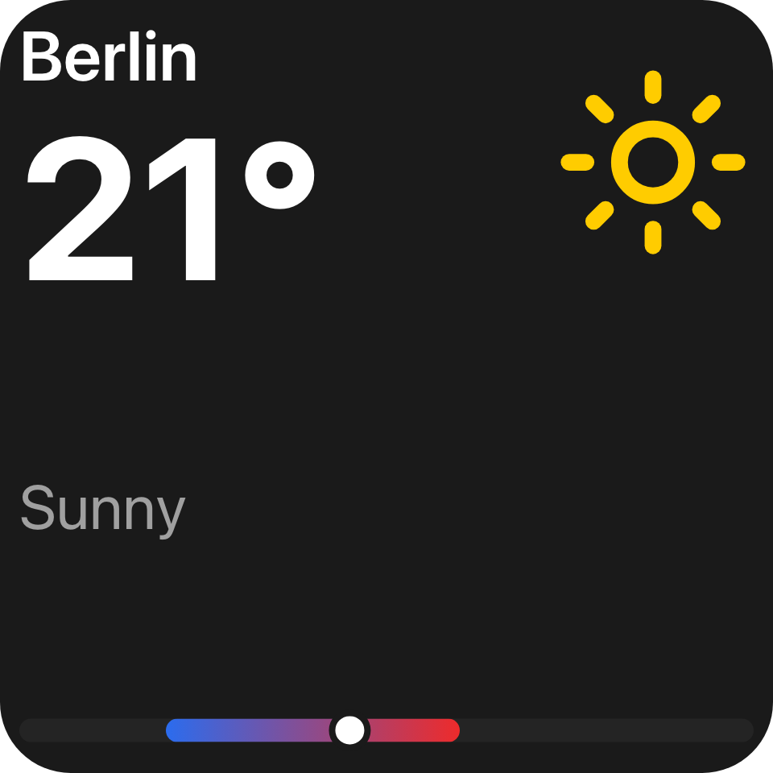

A deck widget is a tile on the deck drawn from your tree, served over a `widget` surface.

## Example

```csharp
public IReadOnlyList<UiSurfaceDeclaration> Surfaces { get; } =
[
    new UiSurfaceDeclaration { Kind = UiSurfaceKinds.Widget, SessionMode = UiSessionModes.Shared },
];

public Task<IUiSession?> CreateSessionAsync(UiSessionRequest request, CancellationToken cancellationToken)
{
    if (request.Surface.Kind != UiSurfaceKinds.Widget)
    {
        return Task.FromResult<IUiSession?>(null);
    }

    var data = request.Surface.Attributes[UiWidgetSurfaceAttributes.Data];
    var city = data.TryGetProperty("city", out var value) ? value.GetString() : null;

    var view = new UiView(request.Surface, Weather(city ?? "Berlin"));
    return Task.FromResult<IUiSession?>(new ViewSession(view));
}

private UiStack Weather(string city) => new()
{
    Key = "weather",
    Justify = UiComponentJustify.SpaceBetween,
    Children =
    [
        new UiStack
        {
            Key = "current",
            Direction = UiComponentDirections.Horizontal,
            Justify = UiComponentJustify.SpaceBetween,
            Children =
            [
                new UiStack
                {
                    Key = "labels",
                    Children =
                    [
                        new UiTextRun { Key = "location", Text = city, Size = 0.09 },
                        new UiTextRun { Key = "temp", Text = UiText.From(() => $"{_forecast.Value.Temperature}°"), Size = 0.26 },
                    ],
                },
                new UiImage { Key = "icon", Source = _sun, Size = 0.26 },
            ],
        },
        new UiTextRun
        {
            Key = "condition",
            Text = UiText.From(() => _forecast.Value.Condition),
            Size = 0.08,
            Role = UiComponentTextRoles.Secondary,
        },
        new UiRangeBar { Key = "range", MainSize = 0.06, Start = 0.2, End = 0.6, Marker = 0.45 },
    ],
};
```



To offer a widget in the picker, register a [widget type](/ui/views/widget-types/) - that page covers
registration, the picker card and configuration. The same vocabulary also draws a
[folder view](/ui/views/folder-views/) and an [action modal](/ui/views/modal/).

## Forwarding to a UiView

`ViewSession`, the adapter between a `UiView` and `IUiSession` used on every view page, is defined on
[Serving a view](/ui/views/sessions/#example).

## What the surface carries

| Attribute (`UiWidgetSurfaceAttributes`) | Meaning |
| --- | --- |
| `widgetId` | The widget being drawn. |
| `widgetType` | Its qualified widget type id. |
| `data` | Its stored configuration, as JSON. |
| `cornerRadius` | The tile's corner radius. |
| `sample` | `true` when the picker asks for a representative sample. |
| `culture` | The language Macro Deck is set to, for example `de` or `pt-BR`. Absent on a Macro Deck that predates it. |
| `ghost` | `true` when drawing the drag ghost of a widget that is also drawn live. |

The surface carries no size: a widget is resized on the deck without asking you. To lay a 2x1 or 1x2 tile
out differently from a 1x1 one, use [`UiResponsive`](/ui/components/responsive/), which the reader resolves
against the tile.

The stored configuration travels with the request rather than being looked up, so a provider outside
the host can serve a widget. A provider that ignores `sample` or `ghost` keeps behaving exactly as it
did.

For a type that declares [standard appearance](/ui/views/widget-types/#standard-appearance),
`UiWidgetAppearance.Read(data)` returns the background, label, colours and font the user or an action set.

`UiWidgetSurface` in `MacroDeck.Ui.Widgets` reads these leniently, so a missing or malformed attribute
reads as absent rather than throwing:

| Member | Answers |
| --- | --- |
| `IsFor(surface, widgetType)` | Whether a `widget` or `preview` surface draws your widget type. |
| `IsConfigurationFor(surface, widgetType)` | Whether a `config` surface is the `widget-config` entry point of your widget type. |
| `Data(surface)` | The stored configuration (`data`, or `widgetData` on a configuration surface); an empty object when absent. |
| `WidgetId(surface)` | The stored widget, or `null` for a preview or an unsaved widget. |
| `IsSampleRequested(surface)` | Whether a `preview` asks for a picker sample. |
| `Culture(surface)` | The language to write the widget's own text in, or `null` when the surface names none. |

Labels and other localized text in your tree need no culture: each client resolves them in its reader's
language. `culture` is for text the widget draws as content, such as the names and messages of a picker
sample, which travel as literal text. Resolve those with your own catalog in that culture and fall back to
your default language when it is absent.

## Keeping content clear of the corner

A tile is a rounded rectangle, and content laid out to its edge runs under the curve.
`UiWidgetSafeArea.For(surface)` is the padding a tile keeps: what the tile's `cornerRadius` intrudes on its
diagonal, but never less than `BreathingRoom`, the default gap between two tiles. A surface without a
corner radius, such as a preview, uses `DefaultCornerRadius`. `LengthFor(cornerRadius)` returns the same
inset as a `UiLength` for a gap or a size.

```csharp
var root = new UiStack
{
    Key = "root",
    Padding = UiWidgetSafeArea.For(request.Surface),
    Children = [/* ... */],
};
```

## Previews, samples and ghosts

```csharp
var isSample = UiWidgetSurface.IsSampleRequested(request.Surface);
var isGhost = request.Surface.Attributes.TryGetValue(UiWidgetSurfaceAttributes.Ghost, out var ghost)
    && ghost.ValueKind == JsonValueKind.True;
```

An editor preview arrives as a `preview` surface carrying draft configuration instead. A `preview` with
`sample: true` is a picker card: draw it without reading anything live - nothing is connected, bound or
configured while someone is choosing a widget type. `ghost` exists because two surfaces for one widget are
otherwise identical, and without it the ghost and the tile would share a session.

## Artwork

`_sun` above is a [resource handle](/ui/reference/resources/). Get one for your own image from
`IIntegrationContext.UiResources` and register a name again to change the picture; see
[Registering your own images](/ui/reference/resources/#registering-your-own-images).

## See also

- [Widget types](/ui/views/widget-types/)
- [Serving a view](/ui/views/sessions/)
- [Components](/ui/components/)
